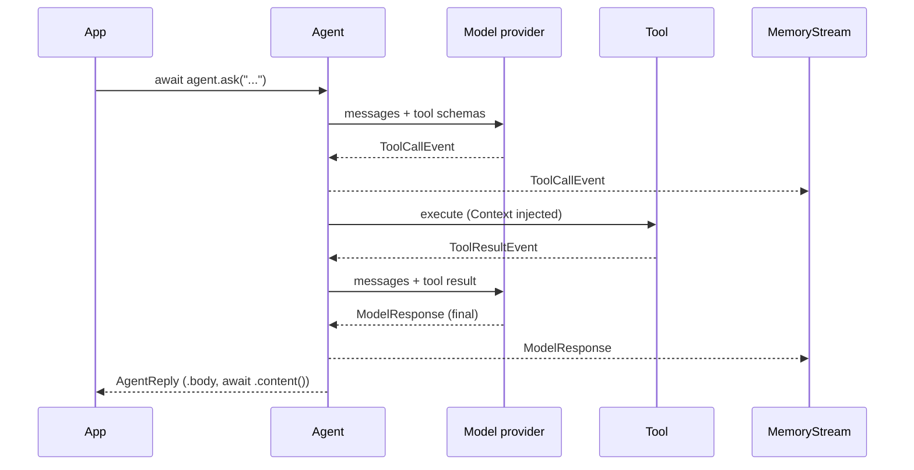
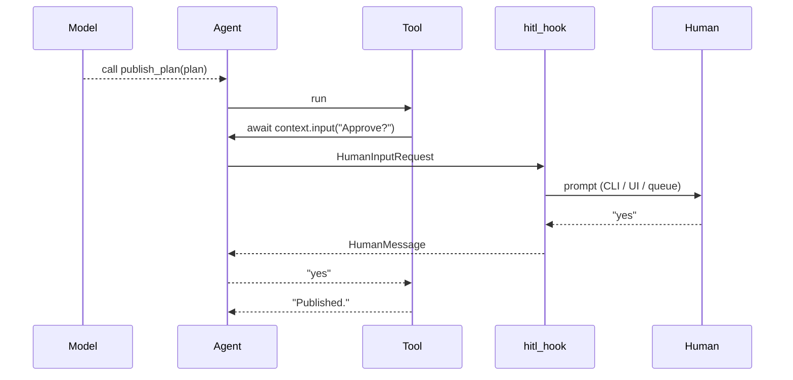
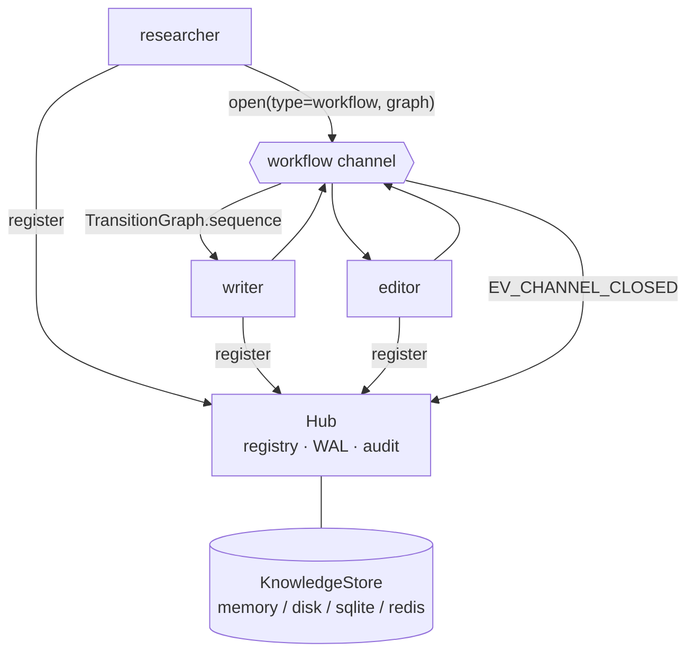
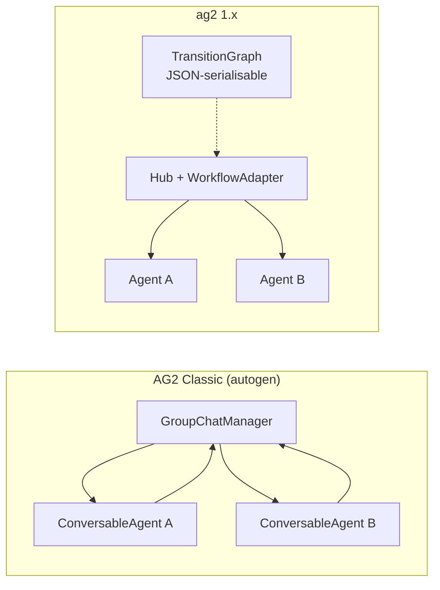
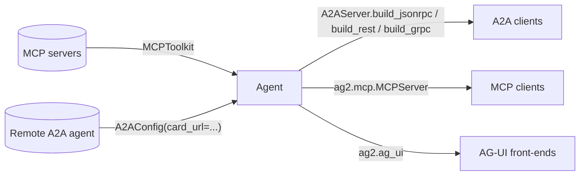

> Diagrams describe the `ag2` %%version=ag2%% (1.x) architecture. Classic (`autogen`) group chats are shown only for comparison.

## One turn: `agent.ask()` and the tool loop

## Human in the loop

## Network: hub, agents and a workflow channel

## Classic GroupChat vs 1.x workflow channel

## Interop surfaces

