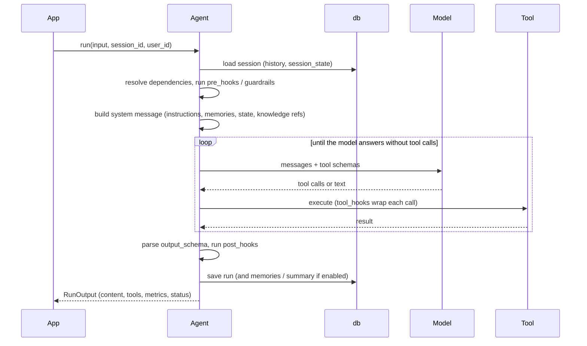
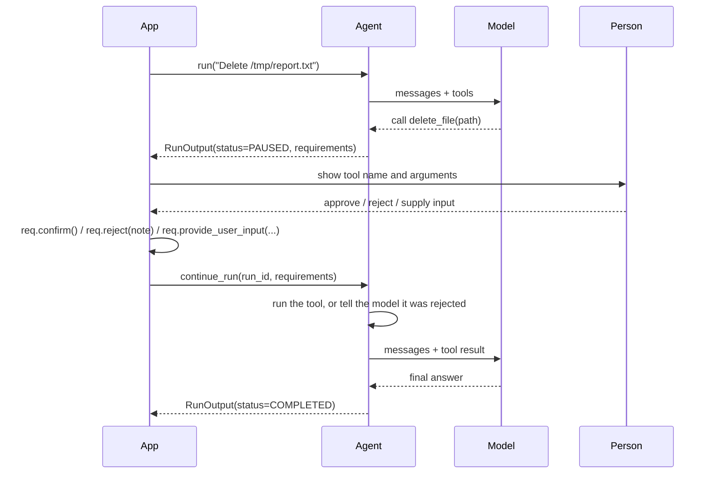
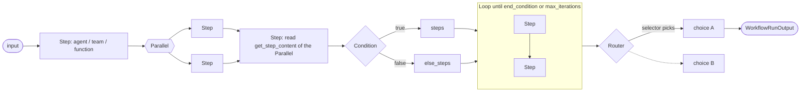
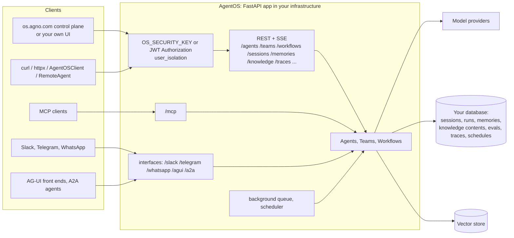
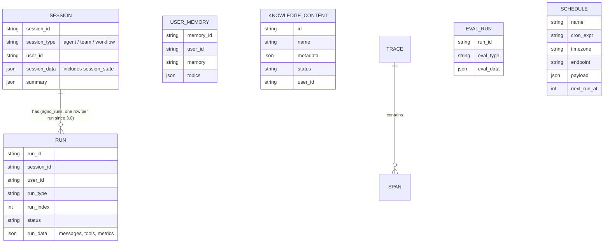

Checked against **agno %%version=agno%%** (checked %%versions-checked%%). These diagrams simplify behaviour that is verified on the linked pages; the pages are the reference.

## The agent run loop

What happens inside `agent.run()` ([comprehensive guide](/agno-guide/agno_comprehensive_guide/)):

A guardrail that raises `InputCheckError` ends the run before the first model call with `status=error`; an `OutputCheckError` sets `status=error` after it.

## Pausing for a person

Tools with `requires_confirmation`, `requires_user_input` or `external_execution` ([human-in-the-loop](/agno-guide/agno_comprehensive_guide/#human-in-the-loop)):

Over HTTP the same exchange is `POST /agents/{id}/runs` followed by `POST /agents/{id}/runs/{run_id}/continue` ([AgentOS](/agno-guide/agno_agentos/#human-in-the-loop-over-http)).

## Team modes

([Teams](/agno-guide/agno_teams/#modes))

```mermaid
flowchart TB
    subgraph coordinate["coordinate (default)"]
        C0[User] --> CL[Leader]
        CL -- delegate_task_to_member --> CA[Member A]
        CL -- delegate_task_to_member --> CB[Member B]
        CA --> CL
        CB --> CL
        CL --> C1[Leader's answer]
    end
    subgraph route
        R0[User] --> RL[Leader]
        RL -- picks one --> RA[Member A]
        RA --> R1[Member's answer returned as is]
    end
    subgraph broadcast
        B0[User] --> BL[Leader]
        BL -- delegate_task_to_members --> BA[Member A]
        BL -- same task --> BB[Member B]
        BA --> BL
        BB --> BL
        BL --> B1[Combined answer]
    end
    subgraph tasks
        T0[User] --> TL[Leader]
        TL -- create_task --> TQ[(Task list in session_state)]
        TL -- execute_task / execute_tasks_parallel --> TA[Members]
        TA --> TQ
        TQ --> TL
        TL -- mark_all_complete or max_iterations --> T1[Answer]
    end
```

## Workflow primitives

([Workflows](/agno-guide/agno_workflows/))

Any step can carry `human_review=HumanReview(...)`, which pauses the run before (or after) it until `continue_run()`.

## AgentOS and its clients

([AgentOS](/agno-guide/agno_agentos/))

The control plane is a browser application that calls your AgentOS directly; your data stays in your database.

## What is stored where

All of these live in the one `db` you give the agent, team, workflow or AgentOS; table names can be changed on the db constructor. Knowledge vectors live in the vector store, with the contents table tracking what was inserted.
