Visual summaries of the main concepts of the Microsoft Agent Framework for .NET. The workflow and hosting diagrams at the end link to the pages that explain them.

---

## 1. System Architecture

### High-Level Framework Design

This diagram shows the layered architecture of the framework, from the core components up to the application layer.

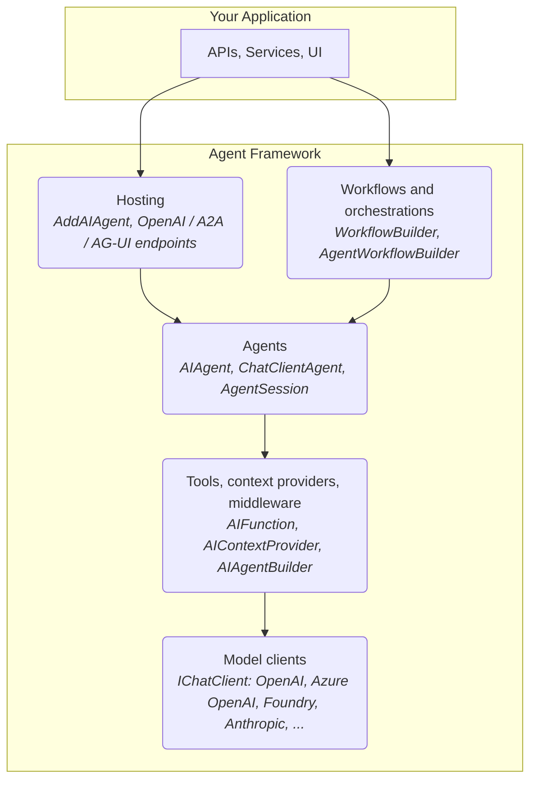

---

## 2. Agent Lifecycle

### A `ChatClientAgent` run

An agent is stateless; the conversation lives in an `AgentSession` that the caller keeps (or a session store keeps for it) between runs.

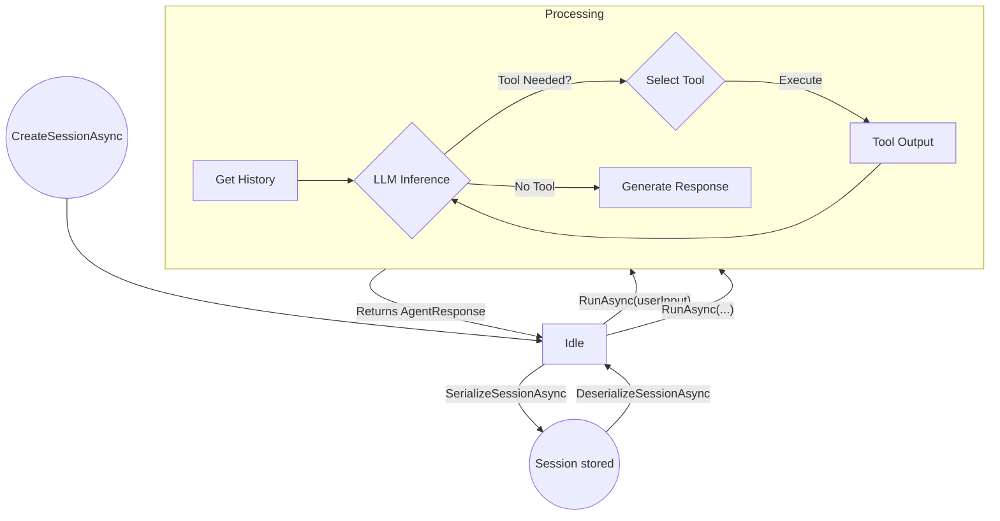

---

## 3. Multi-Agent Orchestration

### Sequential Workflow

Each agent receives the conversation so far and adds its reply (`AgentWorkflowBuilder.BuildSequential`); with `chainOnlyAgentResponses` it sees only the previous agent's reply. See the [orchestrations page](/microsoft-agent-framework-guide/dotnet/microsoft_agent_framework_dotnet_orchestrations/).

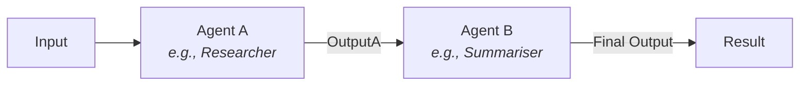

### Router Pattern

A router classifies the request (structured output, or a switch edge in a workflow) and one specialist answers. For specialists that pass the conversation between themselves, use a handoff workflow instead.

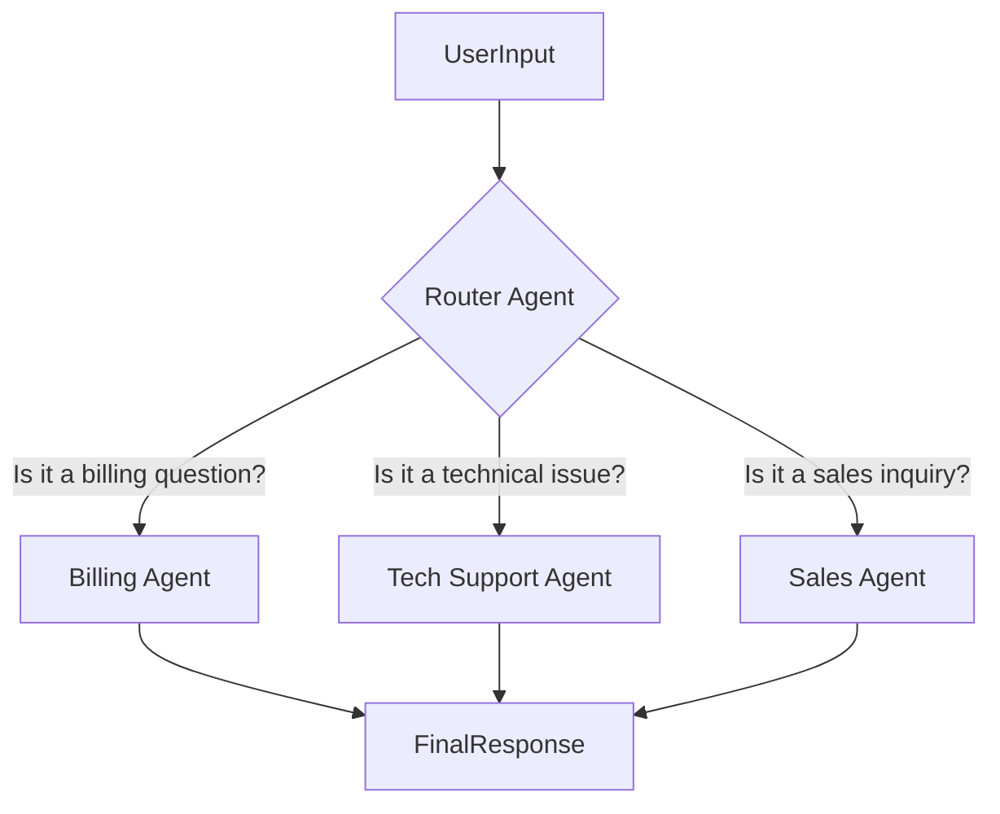

---

## 4. Tool Integration

### Tool Execution Pipeline

This shows how an agent selects and executes a tool.

```mermaid
graph TD
    Agent[Agent Logic] -- "User asks a question" --> LLM{LLM Decides}
    LLM -- "Tool 'GetCurrentWeather' should be called" --> ToolSelection
    
    subgraph Tool Execution
        ToolSelection[Select 'GetCurrentWeather' Tool]
        ToolSelection -- "Invoke with params: { city: 'Seattle' }" --> CSharpTool(C# Method<br/><i>GetCurrentWeather("Seattle")</i>)
        CSharpTool -- "Returns 'Rainy, 55°F'" --> ToolResult
    end

    ToolResult -- "Provide tool output back to LLM" --> LLM
    LLM -- "Formulate final answer" --> AgentResponse[Agent Response to User]
```

---

## 5. Memory Systems

### Multi-Tier Memory Architecture

Agents can access different layers of memory for context.

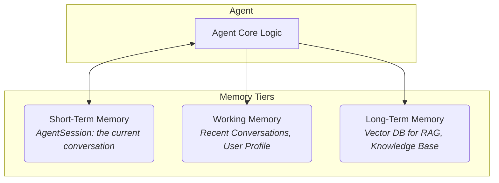

---

## 6. Azure Integration

### Azure Service Ecosystem

This diagram shows how the Agent Framework integrates with key Azure services.

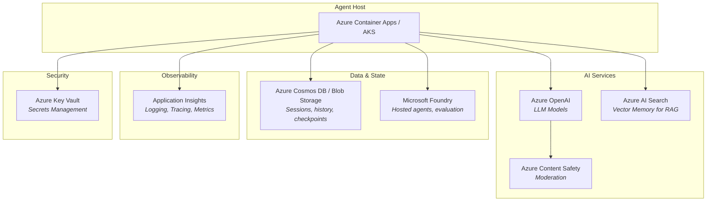

---

## 7. Deployment Architecture

### Production Topology on Azure

A typical high-availability deployment on Azure.

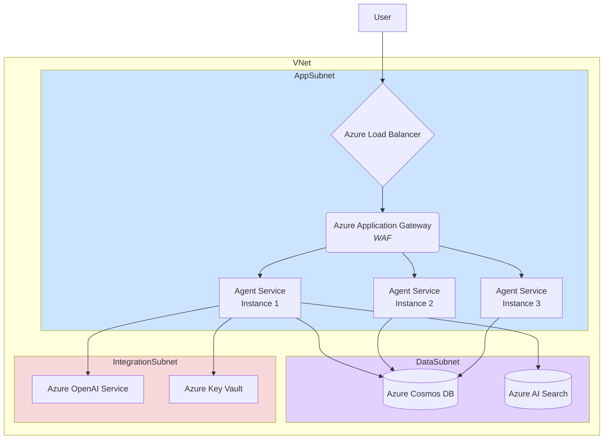

---

## 8. Security & Authentication Flow

### JWT-Based Authentication Flow

This shows a typical flow for securing an agent API.

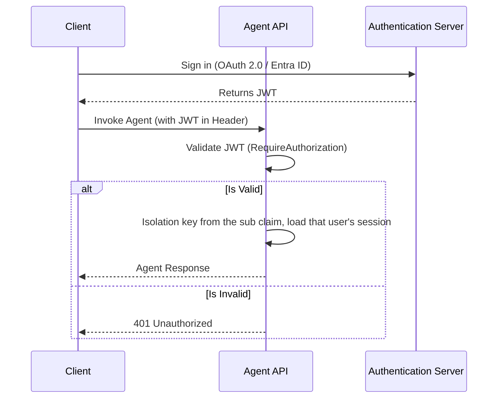

---

## 9. Data Flow

### Complete Request-Response Cycle

This diagram traces a single user request through the entire system.

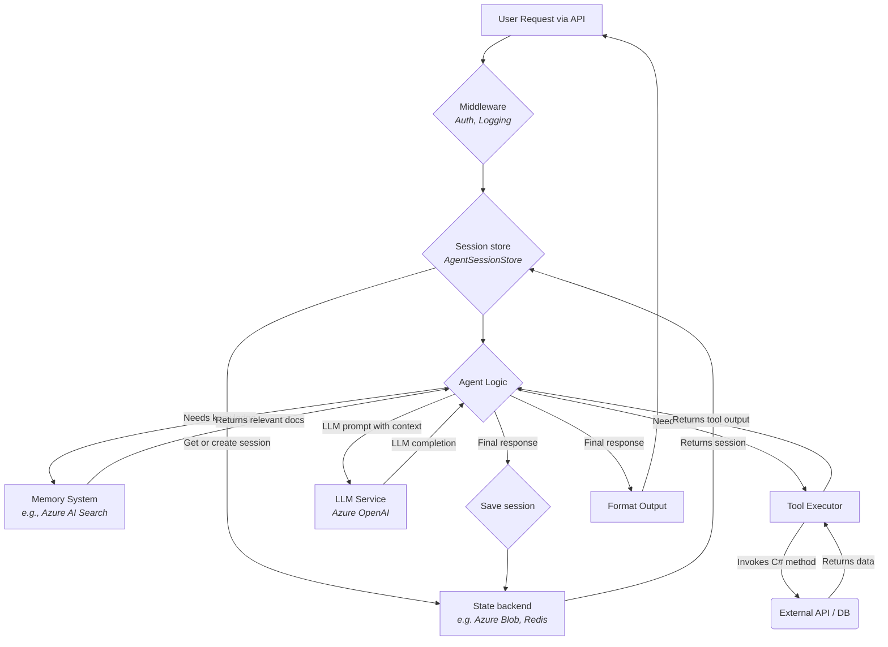

---

## 10. Workflow Supersteps

### How a workflow run proceeds

Messages sent during a superstep are delivered at the start of the next; executors that receive messages in the same superstep run concurrently, and a checkpoint can be taken at the end of each. See the [workflows page](/microsoft-agent-framework-guide/dotnet/microsoft_agent_framework_dotnet_workflows/).

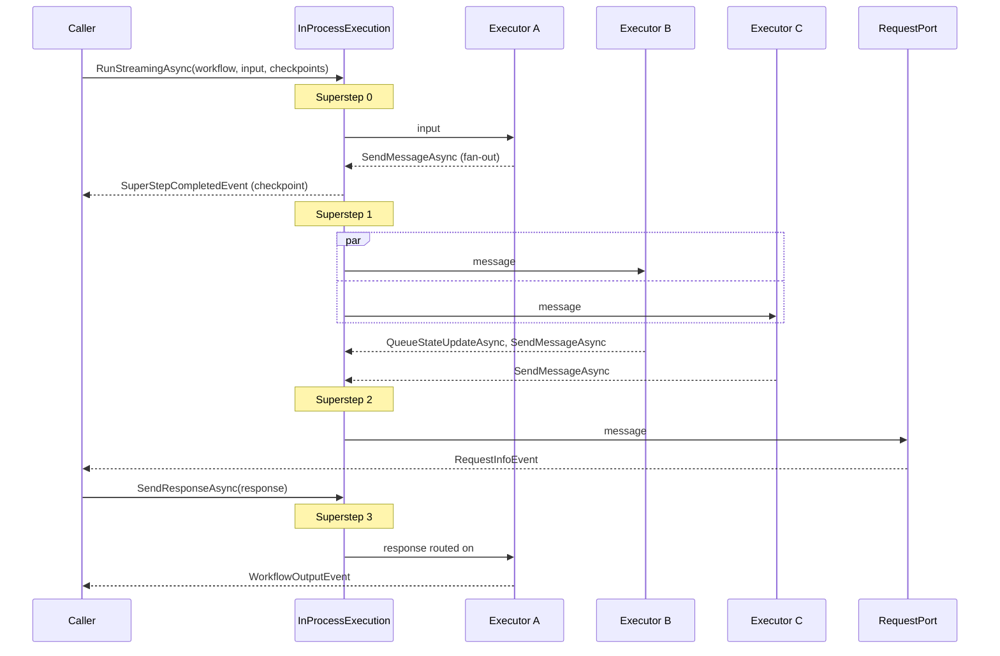

---

## 11. Hosting Endpoints

### One registration, several protocols

Agents and workflows registered with `AddAIAgent` / `AddWorkflow` are keyed services; each `Map...` call exposes them in one protocol. See the [hosting page](/microsoft-agent-framework-guide/dotnet/microsoft_agent_framework_dotnet_hosting/).

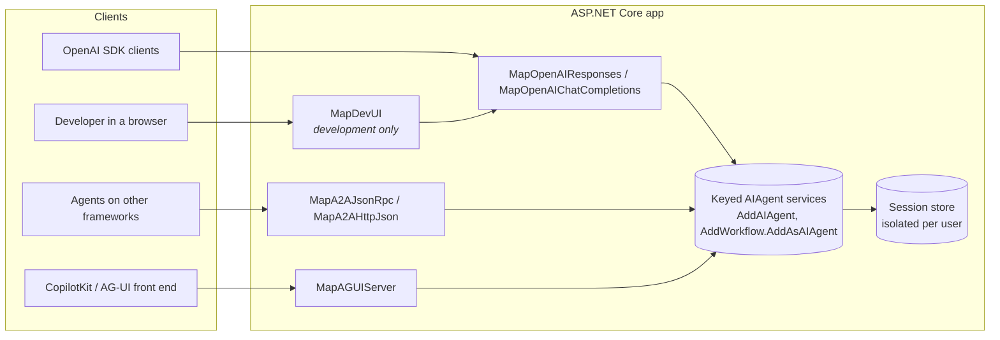
