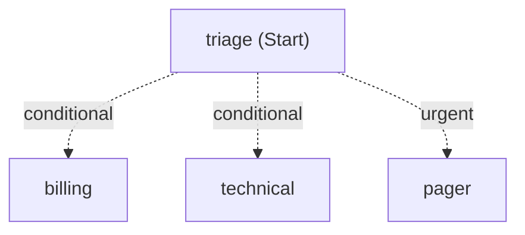

`Microsoft.Agents.AI.Workflows` is a typed graph engine. A workflow is a set of **executors** joined by **edges**. Messages are ordinary .NET objects, and an edge only delivers a message whose type the target can handle. The engine runs in **supersteps** (the Pregel, or bulk-synchronous, model): every message sent during a superstep is delivered at the start of the next one, and the executors that receive messages in a superstep run concurrently. A run finishes when no messages remain, pauses when it is waiting for input from outside, and ends early if an executor throws.

This page covers the engine. The prebuilt multi-agent patterns built on top of it (sequential, concurrent, group chat, handoff and Magentic) are on the [orchestrations page](/microsoft-agent-framework-guide/dotnet/microsoft_agent_framework_dotnet_orchestrations/), serving workflows over HTTP is on the [hosting page](/microsoft-agent-framework-guide/dotnet/microsoft_agent_framework_dotnet_hosting/), and tracing them is on the [observability page](/microsoft-agent-framework-guide/dotnet/microsoft_agent_framework_dotnet_observability/).

Every C# block on this page compiles against `Microsoft.Agents.AI.Workflows` %%version=Microsoft.Agents.AI%% (checked %%versions-checked%%) and was run. The blocks that call a model were run against a local stand-in for the OpenAI API, so the replies they print are not real model output.

```bash
dotnet add package Microsoft.Agents.AI.Workflows --version %%version=Microsoft.Agents.AI%%
dotnet add package Microsoft.Agents.AI.OpenAI --version %%version=Microsoft.Agents.AI%%              # only for the agent examples
dotnet add package Microsoft.Agents.AI.Workflows.Generators --version %%version=Microsoft.Agents.AI%%  # optional source generator
dotnet add package Microsoft.Agents.AI.Workflows.Declarative --version %%version=Microsoft.Agents.AI%% # only for YAML workflows
```

The examples that use an agent share this helper. Set `OPENAI_API_KEY`, and `OPENAI_BASE_URL` if you use a proxy or another OpenAI-compatible server; any `IChatClient` works in its place, including the Azure OpenAI one used elsewhere in this guide.

```csharp
// Models.cs: one chat client for the agent examples.
using System.ClientModel;
using Microsoft.Extensions.AI;
using OpenAI;

public static class Models
{
    public static IChatClient ChatClient()
    {
        var options = new OpenAIClientOptions();
        if (Environment.GetEnvironmentVariable("OPENAI_BASE_URL") is { Length: > 0 } baseUrl)
        {
            options.Endpoint = new Uri(baseUrl);   // a proxy, a local server or another OpenAI-compatible endpoint
        }

        return new OpenAIClient(new ApiKeyCredential(Environment.GetEnvironmentVariable("OPENAI_API_KEY")!), options)
            .GetChatClient(Environment.GetEnvironmentVariable("OPENAI_MODEL") ?? "%%model=openai%%")
            .AsIChatClient();
    }
}
```

## How it differs from Python

The two engines share a design and most of their vocabulary, but the .NET API leans on the type system where Python uses decorators and type hints.

| Concept | .NET | Python |
| --- | --- | --- |
| Executor | Class deriving from `Executor<TIn>`, `Executor<TIn, TOut>` or `Executor`; or a delegate bound with `BindAsExecutor` | `Executor` subclass with `@handler` methods, or an `@executor` function |
| Several handlers on one executor | Override `ConfigureProtocol`, or `[MessageHandler]` methods with the source generator | Several `@handler` methods |
| Sending and yielding | `context.SendMessageAsync`, `context.YieldOutputAsync`; types must be declared (`[SendsMessage]`, `[YieldsOutput]`) unless they are the handler's return type | `ctx.send_message`, `ctx.yield_output`, types taken from `WorkflowContext[...]` hints |
| Running | `InProcessExecution.RunAsync` / `RunStreamingAsync` / `OpenStreamingAsync` | `workflow.run(...)`, `workflow.run(..., stream=True)` |
| Superstep limit | None. A cycle runs until it stops sending | `max_iterations`, 100 by default |
| Human input | A `RequestPort` node in the graph; answers go back with `SendResponseAsync` or `Run.ResumeAsync` | `ctx.request_info(...)` plus a `@response_handler` |
| Checkpoint storage | A `CheckpointManager` passed when the run starts | `checkpoint_storage=` on the builder or the run |
| Agents as nodes | An `AIAgent` converts to an executor; it waits for a `TurnToken` before calling the model | `AgentExecutor`, which runs when it receives a request |
| Shared state | `QueueStateUpdateAsync` / `ReadStateAsync` with optional named scopes | `ctx.set_state` / `ctx.get_state` |
| Declarative workflows | `Microsoft.Agents.AI.Workflows.Declarative` (YAML, Power Fx expressions) | `agent-framework-declarative` |

There is no .NET counterpart to Python's functional workflow API (`@workflow` functions); build the graph with `WorkflowBuilder`.

## A first workflow

An executor deriving from `Executor<TInput, TOutput>` overrides one `HandleAsync` method. Its return value is sent along every outgoing edge and, if the executor is named in `WithOutputFrom`, becomes workflow output. `WorkflowBuilder` takes the start executor, which receives the run's input.

```csharp
using Microsoft.Agents.AI.Workflows;

// An executor with one input type and one output type. Returning a value sends it along
// every outgoing edge, and yields it as workflow output if the executor is an output source.
public sealed class UppercaseExecutor() : Executor<string, string>("uppercase")
{
    public override ValueTask<string> HandleAsync(string message, IWorkflowContext context, CancellationToken cancellationToken = default) =>
        ValueTask.FromResult(message.ToUpperInvariant());
}

public sealed class ReverseExecutor() : Executor<string, string>("reverse")
{
    public override ValueTask<string> HandleAsync(string message, IWorkflowContext context, CancellationToken cancellationToken = default) =>
        ValueTask.FromResult(new string(message.Reverse().ToArray()));
}

public static class FirstWorkflow
{
    public static Workflow Build()
    {
        var uppercase = new UppercaseExecutor();
        var reverse = new ReverseExecutor();

        return new WorkflowBuilder(uppercase)      // the start executor receives the run's input
            .AddEdge(uppercase, reverse)
            .WithOutputFrom(reverse)                // only reverse's results become workflow output
            .WithName("TextPipeline")
            .Build();
    }

    public static async Task RunAsync()
    {
        await using Run run = await InProcessExecution.RunAsync(Build(), "hello, workflows");

        foreach (WorkflowEvent evt in run.OutgoingEvents)
        {
            if (evt is WorkflowOutputEvent output)
            {
                Console.WriteLine($"{output.ExecutorId}: {output.As<string>()}");   // reverse: SWOLFKROW ,OLLEH
            }
        }

        Console.WriteLine(await run.GetStatusAsync());   // Idle: nothing left to do, no pending requests
    }
}
```

A few things in that example matter more than they look.

`WithOutputFrom` decides what counts as output. Without it the workflow runs exactly the same, but no `WorkflowOutputEvent` is raised at all, so a caller that only looks for outputs sees nothing. An executor that yields while it is not an output source is silently ignored.

Executor IDs must be unique within a workflow. Adding two different instances with the same ID fails at build time with `Cannot bind executor with ID 'x' because an executor with the same ID but different instance is already bound`. `Build()` also fails if an executor cannot be reached from the start executor (`there are unreachable executors: ...`); pass `validateOrphans: false` to skip that check.

The input must be a type the start executor handles. If it is not, nothing happens: the run raises no error and no events beyond the start, and the status is `Idle`. When a workflow seems to do nothing, check the input type first.

After a run that finished normally, `GetStatusAsync()` returns `Idle`. `PendingRequests` means the workflow is waiting for a [response](#human-input-with-request-ports), and `Ended` means the run was ended, which is also what you see after an executor throws.

### Streaming events

`RunStreamingAsync` returns a `StreamingRun` whose `WatchStreamAsync()` yields events as they are raised. Use it for anything a user watches, and for any workflow that asks for input.

```csharp
using Microsoft.Agents.AI.Workflows;

public static class StreamingWorkflow
{
    public static async Task RunAsync()
    {
        await using StreamingRun run = await InProcessExecution.RunStreamingAsync(FirstWorkflow.Build(), "stream me");

        await foreach (WorkflowEvent evt in run.WatchStreamAsync())
        {
            switch (evt)
            {
                case SuperStepStartedEvent step:
                    Console.WriteLine($"-- superstep {step.StepNumber}");
                    break;
                case ExecutorInvokedEvent invoked:
                    Console.WriteLine($"   {invoked.ExecutorId} <- {invoked.Data}");
                    break;
                case ExecutorCompletedEvent completed:
                    Console.WriteLine($"   {completed.ExecutorId} -> {completed.Data}");
                    break;
                case WorkflowOutputEvent output:
                    Console.WriteLine($"output: {output.Data}");
                    break;
                case ExecutorFailedEvent failed:
                    Console.WriteLine($"{failed.ExecutorId} failed: {failed.Data?.Message}");
                    break;
                case WorkflowErrorEvent error:
                    Console.WriteLine($"workflow error: {error.Exception?.InnerException?.Message ?? error.Exception?.Message}");
                    break;
            }
        }
    }
}
```

The events are:

| Event | Raised when | Useful members |
| --- | --- | --- |
| `WorkflowStartedEvent` | The run starts | |
| `SuperStepStartedEvent` / `SuperStepCompletedEvent` | A superstep starts or ends | `StepNumber`; `CompletionInfo.Checkpoint`, `.HasPendingRequests`, `.ActivatedExecutors` |
| `ExecutorInvokedEvent` / `ExecutorCompletedEvent` | An executor receives a message / returns | `ExecutorId`, `Data` (the message or the result) |
| `ExecutorFailedEvent` | An executor throws | `ExecutorId`, `Data` (the exception) |
| `WorkflowOutputEvent` | An output source yields | `ExecutorId`, `Data`, `As<T>()`, `Is<T>(out T)` |
| `AgentResponseUpdateEvent` / `AgentResponseEvent` | An agent node streams a token / finishes a turn | `Update` / `Response` |
| `RequestInfoEvent` | A request port asks for input | `Request` (an `ExternalRequest`) |
| `WorkflowWarningEvent` / `WorkflowErrorEvent` | Something went wrong | `Data` / `Exception` |
| `SubworkflowErrorEvent` / `SubworkflowWarningEvent` | The same, inside a sub-workflow | `SubworkflowId` |

`AgentResponseUpdateEvent` and `AgentResponseEvent` derive from `WorkflowOutputEvent`, so a `case WorkflowOutputEvent` placed first catches them too. Put the more specific cases first.

For a non-streaming run, `Run.OutgoingEvents` holds every event so far and `Run.NewEvents` only those since you last read `NewEvents`. Reading `NewEvents` twice in a row gives an empty sequence the second time, which is easy to trip over when you first count events and then look for the output.

## Executors

### Function executors

A delegate becomes an executor with `BindAsExecutor(id)`. There are overloads for synchronous and asynchronous delegates, with or without the context and a cancellation token, and for handlers that return nothing (`Action<TIn>`, `Func<TIn, ValueTask>`). The cast is needed because C# cannot infer a delegate type from a lambda here.

```csharp
using Microsoft.Agents.AI.Workflows;

public record Order(string Id, decimal Total);

public static class FunctionExecutors
{
    public static Workflow Build()
    {
        // Func<TIn, TOut>: a synchronous transform.
        ExecutorBinding parse = ((Func<string, Order>)(line =>
        {
            string[] parts = line.Split(',');
            return new Order(parts[0], decimal.Parse(parts[1]));
        })).BindAsExecutor("parse");

        // Func<TIn, IWorkflowContext, CancellationToken, ValueTask<TOut>>: async, with access to the context.
        ExecutorBinding addTax = ((Func<Order, IWorkflowContext, CancellationToken, ValueTask<Order>>)(async (order, context, ct) =>
        {
            await context.QueueStateUpdateAsync("last-order", order.Id, scopeName: "audit", cancellationToken: ct);
            return order with { Total = Math.Round(order.Total * 1.2m, 2) };
        })).BindAsExecutor("add-tax");

        // Func<TIn, TOut> again, producing the final string.
        ExecutorBinding format = ((Func<Order, string>)(order => $"{order.Id}: {order.Total:0.00}")).BindAsExecutor("format");

        return new WorkflowBuilder(parse)
            .AddEdge(parse, addTax)
            .AddEdge(addTax, format)
            .WithOutputFrom(format)
            .Build();
    }

    public static async Task RunAsync()
    {
        await using Run run = await InProcessExecution.RunAsync(Build(), "A-17,100.00");
        foreach (WorkflowOutputEvent output in run.OutgoingEvents.OfType<WorkflowOutputEvent>())
        {
            Console.WriteLine(output.Data);   // A-17: 120.00
        }
    }
}
```

A function executor that returns a value sends and yields it like a class-based one. One that returns nothing cannot send or yield anything, because it has no way to declare those types; use a class for that. `FunctionExecutor<TIn>` and `FunctionExecutor<TIn, TOut>` are the classes behind `BindAsExecutor`, if you want to construct one directly and pass `sentMessageTypes` or `outputTypes`.

### Executors that send, yield and loop

`Executor<TInput>` has no return value. It talks to the rest of the graph through the context, and it has to declare what it sends and yields with `[SendsMessage(typeof(T))]` and `[YieldsOutput(typeof(T))]`. An undeclared type fails at run time: `Executor 'guesser' cannot send messages of type 'System.Int32'`, or `Cannot output object of type Int32. Expecting one of [System.String]`. `Executor<TInput, TOutput>` declares `TOutput` for both automatically.

```csharp
using Microsoft.Agents.AI.Workflows;

public enum Hint { Start, TooHigh, TooLow }

public record GuessRange(int Low, int High);

// Executor<TInput> has no return value, so the types it sends and yields must be declared.
// Without [SendsMessage(typeof(int))], SendMessageAsync(int) fails with
// "Executor 'guesser' cannot send messages of type 'System.Int32'".
[SendsMessage(typeof(int))]
public sealed partial class GuessExecutor(int low, int high) : Executor<Hint>("guesser")
{
    public override async ValueTask HandleAsync(Hint hint, IWorkflowContext context, CancellationToken cancellationToken = default)
    {
        // Keep run state in the workflow context, not in fields: fields survive between runs of the same Workflow.
        GuessRange range = await context.ReadOrInitStateAsync("range", () => new GuessRange(low, high), cancellationToken: cancellationToken);
        int last = (range.Low + range.High) / 2;
        range = hint switch
        {
            Hint.TooHigh => range with { High = last - 1 },
            Hint.TooLow => range with { Low = last + 1 },
            _ => range,
        };
        await context.QueueStateUpdateAsync("range", range, cancellationToken: cancellationToken);
        await context.SendMessageAsync((range.Low + range.High) / 2, cancellationToken: cancellationToken);
    }
}

[SendsMessage(typeof(Hint))]
[YieldsOutput(typeof(string))]
public sealed partial class JudgeExecutor(int target, int maxTries) : Executor<int>("judge")
{
    public override async ValueTask HandleAsync(int guess, IWorkflowContext context, CancellationToken cancellationToken = default)
    {
        int tries = await context.ReadOrInitStateAsync("tries", () => 0, cancellationToken: cancellationToken) + 1;
        await context.QueueStateUpdateAsync("tries", tries, cancellationToken: cancellationToken);

        if (guess == target)
        {
            await context.YieldOutputAsync($"Found {target} in {tries} tries.", cancellationToken);
        }
        else if (tries >= maxTries)
        {
            // There is no built-in superstep limit, so a loop needs its own way out.
            await context.YieldOutputAsync($"Gave up after {tries} tries.", cancellationToken);
        }
        else
        {
            await context.SendMessageAsync(guess > target ? Hint.TooHigh : Hint.TooLow, cancellationToken: cancellationToken);
        }
    }
}

public static class GuessingLoop
{
    public static async Task RunAsync()
    {
        var guesser = new GuessExecutor(1, 100);
        var judge = new JudgeExecutor(target: 42, maxTries: 10);

        Workflow workflow = new WorkflowBuilder(guesser)
            .AddEdge(guesser, judge)
            .AddEdge(judge, guesser)          // a cycle: allowed
            .WithOutputFrom(judge)
            .Build();

        await using Run run = await InProcessExecution.RunAsync(workflow, Hint.Start);
        Console.WriteLine(run.OutgoingEvents.OfType<WorkflowOutputEvent>().Single().Data);   // Found 42 in 7 tries.
    }
}
```

Two points from that example apply to every executor.

There is no superstep limit. Python stops a run after `max_iterations` supersteps (100 by default); .NET keeps going for as long as executors send messages, which in a test ran 5,000 supersteps in about a tenth of a second. A cycle needs its own termination condition, like `maxTries` above, or a call to `RequestHaltAsync()`.

Executor instances outlive runs. A `Workflow` holds the executor objects you gave it, so a field set during one run is still set at the start of the next run of the same `Workflow`, while state kept in the context starts fresh. Keep per-run state in the context (or in a [`StatefulExecutor`](#stateful-executors)), bind executors through [factories](#concurrent-runs-and-executor-factories), or build a new `Workflow` per run.

The `partial` keyword on these classes is there for the source generator (next section). With `Microsoft.Agents.AI.Workflows.Generators` referenced, `[SendsMessage]` or `[YieldsOutput]` on a class that is not `partial` is a compile error (`MAFGENWF008`); without the generator, `partial` does nothing. Writing it always keeps the code valid either way.

### Executors with several handlers

To accept more than one message type, derive from `Executor` directly and register a handler per type in `ConfigureProtocol`. `RouteBuilder.AddHandler<TIn>` and `AddHandler<TIn, TResult>` take delegates (with or without a cancellation token, synchronous or returning `ValueTask`), and `AddCatchAll` receives anything else as a `PortableValue`. Declare outputs on the `ProtocolBuilder` with `YieldsOutput<T>()` and extra sent types with `SendsMessage<T>()`.

```csharp
using Microsoft.Agents.AI.Workflows;

public record Refund(string OrderId, decimal Amount);
public record Complaint(string OrderId, string Text);

// One executor, several input types: register a handler per type in ConfigureProtocol.
public sealed class TicketDesk() : Executor("ticket-desk")
{
    protected override ProtocolBuilder ConfigureProtocol(ProtocolBuilder protocolBuilder) =>
        protocolBuilder
            .ConfigureRoutes(routes => routes
                .AddHandler<Refund, string>((refund, context) => $"Refund of {refund.Amount:0.00} queued for {refund.OrderId}")
                .AddHandler<Complaint, string>(this.HandleComplaintAsync)
                .AddCatchAll((value, context) => context.AddEventAsync(new WorkflowWarningEvent($"Unrouted message of type {value.TypeId.TypeName}"))))
            .YieldsOutput<string>();

    private async ValueTask<string> HandleComplaintAsync(Complaint complaint, IWorkflowContext context, CancellationToken cancellationToken)
    {
        await context.QueueStateUpdateAsync(complaint.OrderId, complaint.Text, scopeName: "complaints", cancellationToken);
        return $"Complaint about {complaint.OrderId} logged";
    }
}

public static class MultiHandlerDemo
{
    public static async Task RunAsync()
    {
        var desk = new TicketDesk();
        Workflow workflow = new WorkflowBuilder(desk).WithOutputFrom(desk).Build();

        object[] inputs = [new Refund("A-1", 12.5m), new Complaint("A-2", "Late delivery"), 42];
        foreach (object input in inputs)
        {
            await using Run run = await InProcessExecution.RunAsync(workflow, input);
            foreach (WorkflowEvent evt in run.OutgoingEvents)
            {
                if (evt is WorkflowOutputEvent output) Console.WriteLine(output.Data);
                if (evt is WorkflowWarningEvent warning) Console.WriteLine($"warning: {warning.Data}");
            }
        }
    }
}
```

A catch-all also changes the "wrong input does nothing" behaviour described above, since every message now has a handler.

With the `Microsoft.Agents.AI.Workflows.Generators` package, the same thing is shorter: mark methods with `[MessageHandler]` on a `partial` class deriving from `Executor`, and the generator writes `ConfigureProtocol` for you. Handler methods may be private. Their return types are declared as sent and yielded types, and `[MessageHandler(Send = [...], Yield = [...])]` adds others.

```csharp
using Microsoft.Agents.AI.Workflows;

public record Draft(string Text, int Revision);
public record Review(bool Approved, string Notes);

// With Microsoft.Agents.AI.Workflows.Generators referenced, [MessageHandler] methods on a
// partial Executor are wired up at compile time: no ConfigureProtocol override needed.
public sealed partial class EditorExecutor() : Executor("editor")
{
    [MessageHandler]
    private ValueTask<Draft> HandleBriefAsync(string brief, IWorkflowContext context, CancellationToken cancellationToken = default) =>
        ValueTask.FromResult(new Draft($"Draft: {brief}", 1));

    [MessageHandler]
    private ValueTask<Draft> HandleReviewAsync(Review review, IWorkflowContext context, CancellationToken cancellationToken = default) =>
        ValueTask.FromResult(new Draft($"Revised after: {review.Notes}", 2));
}

[SendsMessage(typeof(Review))]
[YieldsOutput(typeof(string))]
public sealed partial class ReviewerExecutor() : Executor<Draft>("reviewer")
{
    public override async ValueTask HandleAsync(Draft draft, IWorkflowContext context, CancellationToken cancellationToken = default)
    {
        if (draft.Revision >= 2)
        {
            await context.YieldOutputAsync($"Approved revision {draft.Revision}: {draft.Text}", cancellationToken);
        }
        else
        {
            await context.SendMessageAsync(new Review(false, "shorter, please"), cancellationToken: cancellationToken);
        }
    }
}

public static class EditorLoop
{
    public static async Task RunAsync()
    {
        var editor = new EditorExecutor();
        var reviewer = new ReviewerExecutor();
        Workflow workflow = new WorkflowBuilder(editor)
            .AddEdge(editor, reviewer)
            .AddEdge(reviewer, editor)
            .WithOutputFrom(reviewer)
            .Build();

        await using Run run = await InProcessExecution.RunAsync(workflow, "launch announcement");
        Console.WriteLine(run.OutgoingEvents.OfType<WorkflowOutputEvent>().Single().Data);
    }
}
```

Without the generator package that class does not compile, because `ConfigureProtocol` is abstract.

### Executor options and lifecycle hooks

`ExecutorOptions` has two switches, both `true` by default: `AutoSendMessageHandlerResultObject` (send a handler's return value) and `AutoYieldOutputHandlerResultObject` (yield it if the executor is an output source). Its constructor is internal, so you pass options through the `StatefulExecutorOptions` subclass or the constructors of the built-in executors rather than creating your own.

An executor can override these `protected` hooks:

| Hook | Called |
| --- | --- |
| `InitializeAsync` | Once per executor instance, before its first message |
| `OnMessageDeliveryStartingAsync` | Once per superstep in which the executor receives messages, before the first |
| `OnMessageDeliveryFinishedAsync` | Once per such superstep, after the last; used for [fan-in batching](#fan-out-and-fan-in) below |
| `OnCheckpointingAsync` | Before a checkpoint is saved |
| `OnCheckpointRestoredAsync` | After a checkpoint is loaded |

`RegisterCheckpointRestoringCallback` registers state restoration that must finish, across the whole workflow, before any executor's `OnCheckpointRestoredAsync` runs.

## Edges and routing

| Method | Delivers |
| --- | --- |
| `AddEdge(source, target)` | Every message the target can handle. `label:` names the edge in diagrams; `idempotent: true` ignores a duplicate |
| `AddEdge<T>(source, target, condition)` | Messages of type `T` for which `condition` is true. The condition receives `T?` |
| `AddSwitch(source, sw => sw.AddCase<T>(...).WithDefault(...))` | Each message to the first matching case, or the default |
| `AddFanOutEdge(source, targets)` | Each message to every target |
| `AddFanOutEdge<T>(source, targets, selector)` | Each message to the targets whose indices the selector returns |
| `AddFanInBarrierEdge(sources, target)` | Nothing until every source has sent, then all their messages together |
| `AddChain(source, [a, b, c])` | Shorthand for `source → a → b → c` |
| `ForwardMessage<T>(source, targets, condition)` / `ForwardExcept<T>(...)` | Messages of type `T` (or of every type except `T`) |
| `AddExternalCall<TRequest, TResponse>(source, portId)` | Adds a [request port](#human-input-with-request-ports) after `source` and an edge back |

### Conditional edges

Each conditional edge is evaluated on its own, so a message that matches two conditions goes down both edges. The condition receives `T?` because a message of another type may arrive on the same edge; check for `null`.

```csharp
using Microsoft.Agents.AI.Workflows;

public record Ticket(string Id, string Category, int Priority);

public static class ConditionalRouting
{
    public static Workflow Build()
    {
        ExecutorBinding triage = ((Func<string, Ticket>)(text => new Ticket(
            Id: Guid.NewGuid().ToString("N")[..6],
            Category: text.Contains("invoice", StringComparison.OrdinalIgnoreCase) ? "billing" : "technical",
            Priority: text.Contains("urgent", StringComparison.OrdinalIgnoreCase) ? 1 : 3))).BindAsExecutor("triage");

        ExecutorBinding billing = ((Func<Ticket, string>)(t => $"{t.Id} -> billing queue")).BindAsExecutor("billing");
        ExecutorBinding technical = ((Func<Ticket, string>)(t => $"{t.Id} -> technical queue")).BindAsExecutor("technical");
        ExecutorBinding pager = ((Func<Ticket, string>)(t => $"{t.Id} -> paged the on-call engineer")).BindAsExecutor("pager");

        return new WorkflowBuilder(triage)
            // The condition sees the message as T?, so guard against null.
            .AddEdge<Ticket>(triage, billing, t => t?.Category == "billing")
            .AddEdge<Ticket>(triage, technical, t => t?.Category == "technical")
            // Conditions are independent: an urgent technical ticket matches two edges and goes to both.
            .AddEdge<Ticket>(triage, pager, t => t?.Priority == 1, label: "urgent")
            .WithOutputFrom(billing, technical, pager)
            .Build();
    }

    public static async Task RunAsync()
    {
        foreach (string text in new[] { "Invoice is wrong", "URGENT: site is down" })
        {
            await using Run run = await InProcessExecution.RunAsync(Build(), text);
            foreach (WorkflowOutputEvent output in run.OutgoingEvents.OfType<WorkflowOutputEvent>())
            {
                Console.WriteLine($"{text}: {output.Data}");
            }
        }
    }
}
```

### Switch

`AddSwitch` makes the cases exclusive: they are tried in order, the first match wins, and `WithDefault` takes anything that matched nothing. A message that matches no case and has no default is dropped.

```csharp
using Microsoft.Agents.AI.Workflows;

public static class SwitchRouting
{
    public static Workflow Build()
    {
        ExecutorBinding classify = ((Func<string, Ticket>)(text => new Ticket("T-1", text.Split(':')[0], 2))).BindAsExecutor("classify");
        ExecutorBinding billing = ((Func<Ticket, string>)(t => "billing handled it")).BindAsExecutor("billing");
        ExecutorBinding shipping = ((Func<Ticket, string>)(t => "shipping handled it")).BindAsExecutor("shipping");
        ExecutorBinding human = ((Func<Ticket, string>)(t => $"no rule for '{t.Category}', sent to a person")).BindAsExecutor("human");

        // Cases are tried in order and the first match wins; the default takes everything else.
        return new WorkflowBuilder(classify)
            .AddSwitch(classify, sw => sw
                .AddCase<Ticket>(t => t?.Category == "billing", billing)
                .AddCase<Ticket>(t => t?.Category == "shipping", shipping)
                .WithDefault(human))
            .WithOutputFrom(billing, shipping, human)
            .Build();
    }

    public static async Task RunAsync()
    {
        foreach (string text in new[] { "billing: refund", "shipping: late", "legal: contract" })
        {
            await using Run run = await InProcessExecution.RunAsync(Build(), text);
            Console.WriteLine(run.OutgoingEvents.OfType<WorkflowOutputEvent>().Single().Data);
        }
    }
}
```

### Fan-out and fan-in

`AddFanOutEdge` sends each message to every target, and because they receive it in the same superstep they run concurrently. `AddFanInBarrierEdge` holds messages until every source has sent one, then delivers them all to the target in one superstep. The target's handler is called once per message; to act on the whole batch, collect in the handler and act in `OnMessageDeliveryFinishedAsync`, or keep a list in state as in the [shared state example](#shared-state).

```csharp
using Microsoft.Agents.AI.Workflows;

public record Document(string Id, string Text);
public record Finding(string Check, string Result);

public static class ParallelReview
{
    public static Workflow Build()
    {
        ExecutorBinding load = ((Func<string, Document>)(text => new Document("doc-1", text))).BindAsExecutor("load");
        ExecutorBinding spelling = ((Func<Document, Finding>)(d => new Finding("spelling", "no errors"))).BindAsExecutor("spelling");
        ExecutorBinding length = ((Func<Document, Finding>)(d => new Finding("length", $"{d.Text.Length} characters"))).BindAsExecutor("length");
        ExecutorBinding legal = ((Func<Document, Finding>)(d => new Finding("legal", "needs sign-off"))).BindAsExecutor("legal");
        var report = new ReportExecutor();

        return new WorkflowBuilder(load)
            // Every target receives the message, and the three run in the same superstep.
            .AddFanOutEdge(load, [spelling, length, legal])
            // The barrier waits until every source has sent, then delivers all their messages together.
            .AddFanInBarrierEdge([spelling, length, legal], report)
            .WithOutputFrom(report)
            .Build();
    }

    public static async Task RunAsync()
    {
        foreach (string text in new[] { "Draft contract for review." })
        {
            await using Run run = await InProcessExecution.RunAsync(Build(), text);
            foreach (WorkflowEvent evt in run.OutgoingEvents)
            {
                if (evt is WorkflowOutputEvent output) Console.WriteLine(output.Data);
            }
        }
    }
}

// The fan-in target receives one message per branch, in the same superstep.
[YieldsOutput(typeof(string))]
public sealed partial class ReportExecutor() : Executor<Finding>("report")
{
    private readonly List<Finding> _batch = [];

    public override ValueTask HandleAsync(Finding finding, IWorkflowContext context, CancellationToken cancellationToken = default)
    {
        this._batch.Add(finding);
        return default;
    }

    // Runs once per superstep after every message has been delivered.
    protected override async ValueTask OnMessageDeliveryFinishedAsync(IWorkflowContext context, CancellationToken cancellationToken = default)
    {
        if (this._batch.Count > 0)
        {
            await context.YieldOutputAsync(string.Join("; ", this._batch.Select(f => $"{f.Check}: {f.Result}")), cancellationToken);
            this._batch.Clear();
        }
    }
}
```

The order in which the branches' messages arrive is not fixed. Exceptions in one branch do not stop the others in the same superstep: they finish, and then the run ends with the error.

### Multi-selection

A fan-out edge with a selector sends each message to a subset of its targets. The selector gets the message and the number of targets and returns target indices.

```csharp
using Microsoft.Agents.AI.Workflows;

public record Email(string From, string Body);

public static class MultiSelection
{
    public static Workflow Build()
    {
        ExecutorBinding receive = ((Func<string, Email>)(raw => new Email(raw.Split('|')[0], raw.Split('|')[1]))).BindAsExecutor("receive");
        ExecutorBinding spam = ((Func<Email, string>)(e => $"quarantined mail from {e.From}")).BindAsExecutor("spam");
        ExecutorBinding reply = ((Func<Email, string>)(e => $"drafted a reply to {e.From}")).BindAsExecutor("reply");
        ExecutorBinding summarise = ((Func<Email, string>)(e => $"summarised {e.Body.Length} characters")).BindAsExecutor("summarise");

        return new WorkflowBuilder(receive)
            // The selector gets the message and the number of targets and returns the indices to send to.
            .AddFanOutEdge<Email>(receive, [spam, reply, summarise], (email, targetCount) =>
                email!.From.EndsWith(".invalid") ? [0]
                : email.Body.Length > 40 ? [1, 2]
                : [1])
            .WithOutputFrom(spam, reply, summarise)
            .Build();
    }

    public static async Task RunAsync()
    {
        string[] inbox =
        [
            "promo@deals.invalid|You have won",
            "ana@contoso.com|Can we meet on Friday?",
            "raj@contoso.com|Here are the minutes from today's planning session, with actions.",
        ];

        foreach (string raw in inbox)
        {
            await using Run run = await InProcessExecution.RunAsync(Build(), raw);
            Console.WriteLine(string.Join(" + ", run.OutgoingEvents.OfType<WorkflowOutputEvent>().Select(o => o.Data)));
        }
    }
}
```

Do not put a fan-in barrier after a selecting fan-out. The barrier waits for every source, so if the selector skipped a branch the barrier never fires and the run ends with no output and no error.

## Shared state

The context holds key-value state that is part of the run and of its checkpoints. Without a `scopeName`, keys are private to the executor that wrote them; with one, any executor can read them.

| Method | Does |
| --- | --- |
| `QueueStateUpdateAsync<T>(key, value, scopeName)` | Queues a write. Writing `null` removes the key |
| `ReadStateAsync<T>(key, scopeName)` | Reads a value, or `default` |
| `ReadOrInitStateAsync<T>(key, factory, scopeName)` | Reads, or stores and returns the factory's value |
| `ReadStateKeysAsync(scopeName)` | Lists the keys in a scope |
| `QueueClearScopeAsync(scopeName)` | Queues removal of every key in a scope |
| `InvokeWithStateAsync<TState>(func, key, factory, scopeName)` | Reads, lets `func` change the value, and queues the result |

```csharp
using Microsoft.Agents.AI.Workflows;

public static class SharedStateDemo
{
    private const string Scope = "documents";   // a named scope is visible to every executor

    public static Workflow Build()
    {
        // Store the large payload once and pass only its key along the edges.
        ExecutorBinding store = ((Func<string, IWorkflowContext, CancellationToken, ValueTask<string>>)(async (text, context, ct) =>
        {
            string key = Guid.NewGuid().ToString("N");
            await context.QueueStateUpdateAsync(key, text, scopeName: Scope, cancellationToken: ct);
            return key;
        })).BindAsExecutor("store");

        ExecutorBinding words = ((Func<string, IWorkflowContext, CancellationToken, ValueTask<int>>)(async (key, context, ct) =>
        {
            string? text = await context.ReadStateAsync<string>(key, scopeName: Scope, cancellationToken: ct);
            return text?.Split(' ', StringSplitOptions.RemoveEmptyEntries).Length ?? 0;
        })).BindAsExecutor("words");

        ExecutorBinding lines = ((Func<string, IWorkflowContext, CancellationToken, ValueTask<int>>)(async (key, context, ct) =>
        {
            string? text = await context.ReadStateAsync<string>(key, scopeName: Scope, cancellationToken: ct);
            return text?.Split('\n').Length ?? 0;
        })).BindAsExecutor("lines");

        var totals = new TotalsExecutor();

        return new WorkflowBuilder(store)
            .AddFanOutEdge(store, [words, lines])
            .AddFanInBarrierEdge([words, lines], totals)
            .WithOutputFrom(totals)
            .Build();
    }

    public static async Task RunAsync()
    {
        await using Run run = await InProcessExecution.RunAsync(Build(), "first line\nsecond line has more words");
        Console.WriteLine(run.OutgoingEvents.OfType<WorkflowOutputEvent>().Single().Data);   // counts: 2, 6 (order may vary)
    }
}

[YieldsOutput(typeof(string))]
public sealed partial class TotalsExecutor() : Executor<int>("totals")
{
    public override async ValueTask HandleAsync(int count, IWorkflowContext context, CancellationToken cancellationToken = default)
    {
        // The default scope is private to this executor. InvokeWithStateAsync reads, updates and queues in one call.
        await context.InvokeWithStateAsync<List<int>>(
            (counts, ctx, ct) =>
            {
                counts.Add(count);
                return ValueTask.FromResult(counts);
            },
            key: "counts",
            initialStateFactory: () => [],
            cancellationToken: cancellationToken);

        List<int> all = await context.ReadStateAsync<List<int>>("counts", cancellationToken: cancellationToken) ?? [];
        if (all.Count == 2)
        {
            await context.YieldOutputAsync($"counts: {string.Join(", ", all)}", cancellationToken);
        }
    }
}
```

Writes are queued and applied at the end of the superstep. The executor that wrote a value reads it back straight away, but other executors only see it from the next superstep, so two branches of a fan-out cannot exchange values through state. Two executors writing the same key in the same superstep is an error (`Expected exactly one update for key 'k'`) that ends the run. Values are serialised with `System.Text.Json` when the run is checkpointed, so use types that round-trip: records and classes with public properties work; value tuples, whose items are fields, do not.

### Stateful executors

`StatefulExecutor<TState, TInput>` and `StatefulExecutor<TState, TInput, TOutput>` keep one `TState` value in the context under `StateKey` (by default `"{TypeName}.State"`; set `StatefulExecutorOptions.StateKey` and `ScopeName` to change it). `ReadStateAsync`, `QueueStateUpdateAsync` and `InvokeWithStateAsync` are protected helpers. Because the state lives in the context, it is per run and is captured by checkpoints, which is the difference from a field.

```csharp
using Microsoft.Agents.AI.Workflows;

public sealed class RunningTotal
{
    public int Count { get; set; }
    public decimal Sum { get; set; }
}

// StatefulExecutor<TState, TInput, TOutput> keeps TState in the workflow context under one key,
// so it is per run and is captured by checkpoints.
public sealed class AveragingExecutor() : StatefulExecutor<RunningTotal, decimal, string>(
    "average",
    initialStateFactory: () => new RunningTotal(),
    new StatefulExecutorOptions { StateKey = "running-total" })
{
    public override async ValueTask<string> HandleAsync(decimal value, IWorkflowContext context, CancellationToken cancellationToken = default)
    {
        RunningTotal total = await this.ReadStateAsync(context, cancellationToken: cancellationToken);
        total.Count++;
        total.Sum += value;
        await this.QueueStateUpdateAsync(total, context, cancellationToken);
        return $"{total.Count} values, mean {total.Sum / total.Count:0.00}";
    }
}

public static class StatefulDemo
{
    public static async Task RunAsync()
    {
        var average = new AveragingExecutor();
        Workflow workflow = new WorkflowBuilder(average).WithOutputFrom(average).Build();

        // Each value is a separate superstep of the same run; state carries over between them.
        await using StreamingRun run = await InProcessExecution.OpenStreamingAsync(workflow);
        foreach (decimal value in new[] { 10m, 20m, 60m })
        {
            await run.TrySendMessageAsync(value);
        }

        await foreach (WorkflowEvent evt in run.WatchStreamAsync())
        {
            if (evt is WorkflowOutputEvent output) Console.WriteLine(output.Data);
        }
    }
}
```

`OpenStreamingAsync` starts a run without input; each `TrySendMessageAsync` then delivers a message to the start executor. It returns `false` if the message type is not accepted.

## Custom events, halting and errors

Raise your own events with `AddEventAsync` and a class deriving from `WorkflowEvent`. `RequestHaltAsync()` stops the run at the end of the current superstep, discarding messages still queued.

```csharp
using Microsoft.Agents.AI.Workflows;

// Custom events derive from WorkflowEvent; Data carries the payload.
public sealed class ProgressEvent(string stage, int percent) : WorkflowEvent($"{stage}: {percent}%")
{
    public string Stage => stage;
    public int Percent => percent;
}

[SendsMessage(typeof(int))]
[YieldsOutput(typeof(string))]
public sealed partial class BatchExecutor(int batches) : Executor<int>("batch")
{
    public override async ValueTask HandleAsync(int batch, IWorkflowContext context, CancellationToken cancellationToken = default)
    {
        await context.AddEventAsync(new ProgressEvent("import", batch * 100 / batches), cancellationToken);

        if (batch == 3)
        {
            // Stop at the end of this superstep, even though a message is still queued.
            await context.YieldOutputAsync($"stopped after batch {batch}", cancellationToken);
            await context.RequestHaltAsync();
        }

        await context.SendMessageAsync(batch + 1, cancellationToken: cancellationToken);
    }
}

public static class EventsAndHalt
{
    public static async Task RunAsync()
    {
        var batch = new BatchExecutor(batches: 10);
        Workflow workflow = new WorkflowBuilder(batch).AddEdge(batch, batch).WithOutputFrom(batch).Build();

        await using StreamingRun run = await InProcessExecution.RunStreamingAsync(workflow, 1);
        await foreach (WorkflowEvent evt in run.WatchStreamAsync())
        {
            switch (evt)
            {
                case ProgressEvent progress:
                    Console.WriteLine($"{progress.Stage} {progress.Percent}%");
                    break;
                case WorkflowOutputEvent output:
                    Console.WriteLine(output.Data);
                    break;
            }
        }
    }
}
```

An exception in an executor does not propagate out of `RunAsync` or `WatchStreamAsync`. It raises `ExecutorFailedEvent` with the original exception and then `WorkflowErrorEvent` with a `TargetInvocationException` wrapping it, and the run ends. Catch errors you can recover from inside the executor; for the rest, watch for these events.

```csharp
using Microsoft.Agents.AI.Workflows;

public static class ErrorHandling
{
    public static async Task RunAsync()
    {
        ExecutorBinding parse = ((Func<string, int>)(int.Parse)).BindAsExecutor("parse");
        ExecutorBinding square = ((Func<int, int>)(n => n * n)).BindAsExecutor("square");
        Workflow workflow = new WorkflowBuilder(parse).AddEdge(parse, square).WithOutputFrom(square).Build();

        // An exception in an executor does not throw out of RunAsync: it surfaces as two events
        // and the run ends.
        await using Run run = await InProcessExecution.RunAsync(workflow, "not a number");
        foreach (WorkflowEvent evt in run.OutgoingEvents)
        {
            switch (evt)
            {
                case ExecutorFailedEvent failed:
                    Console.WriteLine($"{failed.ExecutorId} failed: {failed.Data?.GetType().Name}: {failed.Data?.Message}");
                    break;
                case WorkflowErrorEvent error:
                    // The exception is a TargetInvocationException wrapping the executor's exception.
                    Console.WriteLine($"workflow error, inner: {error.Exception?.InnerException?.GetType().Name}");
                    break;
            }
        }

        Console.WriteLine(await run.GetStatusAsync());   // Ended
    }
}
```

`StreamingRun.CancelRunAsync()` stops a run and ends the event stream; executors see cancellation through their `CancellationToken`. The cancellation token passed to `WatchStreamAsync` only stops watching: the run carries on.

## Human input with request ports

A `RequestPort<TRequest, TResponse>` is a node. A message sent to it leaves the workflow as a `RequestInfoEvent` carrying an `ExternalRequest`; the caller answers with `request.CreateResponse(value)`, and the response continues from the port along its outgoing edges. While a request is outstanding the run's status is `PendingRequests`, and `WatchStreamAsync()` waits rather than ending.

```csharp
using Microsoft.Agents.AI.Workflows;

public record ExpenseClaim(string Employee, decimal Amount);
public record ApprovalRequest(string Summary, decimal Amount);
public record ApprovalDecision(bool Approved, string? Reason = null);

public static class ExpenseApproval
{
    public static Workflow Build()
    {
        ExecutorBinding intake = ((Func<ExpenseClaim, ApprovalRequest>)(claim =>
            new ApprovalRequest($"{claim.Employee} claims {claim.Amount:0.00}", claim.Amount))).BindAsExecutor("intake");

        // A request port is a node whose input leaves the workflow as a RequestInfoEvent and
        // whose output is whatever the caller sends back.
        RequestPort approval = RequestPort.Create<ApprovalRequest, ApprovalDecision>("manager-approval");

        ExecutorBinding settle = ((Func<ApprovalDecision, string>)(decision =>
            decision.Approved ? "Paid." : $"Rejected: {decision.Reason}")).BindAsExecutor("settle");

        return new WorkflowBuilder(intake)
            .AddEdge(intake, approval)
            .AddEdge(approval, settle)
            .WithOutputFrom(settle)
            .Build();
    }

    // Streaming: answer requests as they arrive; the stream waits while a request is pending.
    public static async Task RunAsync()
    {
        await using StreamingRun run = await InProcessExecution.RunStreamingAsync(Build(), new ExpenseClaim("Ana", 840m));

        await foreach (WorkflowEvent evt in run.WatchStreamAsync())
        {
            switch (evt)
            {
                case RequestInfoEvent { Request: var request } when request.TryGetDataAs(out ApprovalRequest? ask):
                    Console.WriteLine($"[{request.PortInfo.PortId}] {ask.Summary}");
                    ApprovalDecision decision = ask.Amount <= 1000m ? new(true) : new(false, "over the limit");
                    await run.SendResponseAsync(request.CreateResponse(decision));
                    break;
                case WorkflowOutputEvent output:
                    Console.WriteLine(output.Data);
                    break;
            }
        }
    }
}
```

`ExternalRequest` carries `PortInfo` (the port ID and its request and response types), a `RequestId`, and `Data`, which you read with `TryGetDataAs<T>` or `Data.As<T>()`. A response whose type does not match the port's response type throws `InvalidOperationException` from `SendResponseAsync` or `ResumeAsync`. A port can also be the start executor, in which case the run's input becomes the first request.

In a request-response host such as a web API you cannot hold a stream open while a person decides. Use the non-streaming `Run`, which returns at the first halt, answer later with `ResumeAsync`, and combine it with [checkpointing](#checkpointing) so the answer can arrive in a different process.

```csharp
using Microsoft.Agents.AI.Workflows;

public static class ExpenseApprovalTurns
{
    // Non-streaming: RunAsync returns at the first halt; answer the pending requests and resume.
    public static async Task RunAsync()
    {
        await using Run run = await InProcessExecution.RunAsync(ExpenseApproval.Build(), new ExpenseClaim("Raj", 2400m));

        while (await run.GetStatusAsync() == RunStatus.PendingRequests)
        {
            List<ExternalResponse> responses = [];
            foreach (RequestInfoEvent pending in run.NewEvents.OfType<RequestInfoEvent>())
            {
                // In a web app this is where you would store pending.Request.RequestId and return to the user.
                responses.Add(pending.Request.CreateResponse(new ApprovalDecision(false, "needs a director")));
            }

            await run.ResumeAsync(responses);
        }

        // NewEvents only returns what arrived since the last time it was read.
        Console.WriteLine(run.NewEvents.OfType<WorkflowOutputEvent>().Single().Data);   // Rejected: needs a director
    }
}
```

`WatchStreamAsync(blockOnPendingRequest: false)` gives the same "return at the halt" behaviour on a `StreamingRun`. For approval of an agent's tool calls, as opposed to a step in the workflow, see the [orchestrations page](/microsoft-agent-framework-guide/dotnet/microsoft_agent_framework_dotnet_orchestrations/#tool-approval-inside-orchestrations).

## Checkpointing

Pass a `CheckpointManager` when you start a run and the workflow saves a checkpoint at the end of every superstep: executor state in the context, queued messages, pending requests and the state of agent nodes.

| Manager | Storage |
| --- | --- |
| `CheckpointManager.CreateInMemory()` | Memory of this process; for tests and for rolling back within one run |
| `CheckpointManager.Default` | An in-memory manager shared by the process |
| `CheckpointManager.CreateJson(store, jsonOptions)` | Any `ICheckpointStore<JsonElement>`: `FileSystemJsonCheckpointStore`, the Cosmos DB store in `Microsoft.Agents.AI.CosmosNoSql`, or your own `JsonCheckpointStore` subclass |

Each `SuperStepCompletedEvent` carries the new checkpoint in `CompletionInfo.Checkpoint`. The run also exposes `Checkpoints` and `LastCheckpoint`, and `RestoreCheckpointAsync` rolls the same run back to any of them.

```csharp
using Microsoft.Agents.AI.Workflows;

public static class CheckpointTimeTravel
{
    public static async Task RunAsync()
    {
        var guesser = new GuessExecutor(1, 100);
        var judge = new JudgeExecutor(target: 42, maxTries: 10);
        Workflow workflow = new WorkflowBuilder(guesser).AddEdge(guesser, judge).AddEdge(judge, guesser).WithOutputFrom(judge).Build();

        // With a CheckpointManager the run checkpoints at the end of every superstep.
        CheckpointManager checkpoints = CheckpointManager.CreateInMemory();
        await using StreamingRun run = await InProcessExecution.RunStreamingAsync(workflow, Hint.Start, checkpoints);

        await foreach (WorkflowEvent evt in run.WatchStreamAsync())
        {
            if (evt is WorkflowOutputEvent output) Console.WriteLine($"first pass: {output.Data}");
        }

        Console.WriteLine($"{run.Checkpoints.Count} checkpoints, last {run.LastCheckpoint?.CheckpointId}");

        // Roll the same run back to an earlier superstep and let it run forward again.
        await run.RestoreCheckpointAsync(run.Checkpoints[3]);
        await foreach (WorkflowEvent evt in run.WatchStreamAsync())
        {
            if (evt is WorkflowOutputEvent output) Console.WriteLine($"after restore: {output.Data}");
        }
    }
}
```

### Resuming in another process

A `CheckpointInfo` is just a session ID and a checkpoint ID. Store the session ID, and later rebuild the workflow, ask the manager for `GetLatestCheckpointAsync(sessionId)` and call `ResumeStreamingAsync` (or `ResumeAsync`). A request that was pending when the checkpoint was taken is raised again as a fresh `RequestInfoEvent`, so the resumed run's event loop answers it like any other.

```csharp
using Microsoft.Agents.AI.Workflows;
using Microsoft.Agents.AI.Workflows.Checkpointing;

public static class DurableApproval
{
    // Process 1: start the run, persist checkpoints to disk, and stop while the approval is pending.
    public static async Task<string> StartAsync(DirectoryInfo folder)
    {
        using var store = new FileSystemJsonCheckpointStore(folder);
        CheckpointManager checkpoints = CheckpointManager.CreateJson(store);

        await using Run run = await InProcessExecution.RunAsync(ExpenseApproval.Build(), new ExpenseClaim("Mei", 300m), checkpoints);
        Console.WriteLine($"status {await run.GetStatusAsync()}, session {run.SessionId}");
        return run.SessionId;   // store this with the request, e.g. in your database
    }

    // Process 2, possibly days later: rebuild the workflow, find the latest checkpoint and resume.
    public static async Task FinishAsync(DirectoryInfo folder, string sessionId, bool approved)
    {
        using var store = new FileSystemJsonCheckpointStore(folder);
        CheckpointManager checkpoints = CheckpointManager.CreateJson(store);

        CheckpointInfo latest = await checkpoints.GetLatestCheckpointAsync(sessionId)
            ?? throw new InvalidOperationException($"No checkpoint for {sessionId}");

        await using StreamingRun run = await InProcessExecution.ResumeStreamingAsync(ExpenseApproval.Build(), latest, checkpoints);
        await foreach (WorkflowEvent evt in run.WatchStreamAsync())
        {
            switch (evt)
            {
                case RequestInfoEvent pending:   // the pending request is raised again after a resume
                    await run.SendResponseAsync(pending.Request.CreateResponse(new ApprovalDecision(approved, approved ? null : "no receipt")));
                    break;
                case WorkflowOutputEvent output:
                    Console.WriteLine(output.Data);
                    break;
            }
        }
    }

    public static async Task RunAsync()
    {
        var folder = new DirectoryInfo(Path.Combine(Path.GetTempPath(), "expense-checkpoints"));
        string sessionId = await StartAsync(folder);
        await FinishAsync(folder, sessionId, approved: true);
        folder.Delete(recursive: true);
    }
}
```

The workflow you resume with must have the same shape (executor IDs, edges and ports) as the one that wrote the checkpoint. `FileSystemJsonCheckpointStore` writes one JSON file per checkpoint plus an `index.jsonl` in the directory you give it; it is `IDisposable`, so dispose it when you are done. For a database of your own, derive from `JsonCheckpointStore` and implement `CreateCheckpointAsync`, `RetrieveCheckpointAsync` and `RetrieveIndexAsync`. There is no built-in pruning: delete old checkpoints from the store yourself.

### Executor fields and checkpoints

Only context state is captured. If an executor keeps state in fields, save it in `OnCheckpointingAsync` and read it back in `OnCheckpointRestoredAsync`:

```csharp
using Microsoft.Agents.AI.Workflows;

// If an executor keeps state in fields, save and restore it with the checkpoint hooks;
// otherwise a resumed run starts with whatever the fields happen to hold.
[YieldsOutput(typeof(string))]
public sealed partial class DeduplicatingExecutor() : Executor<string>("dedupe")
{
    private const string StateKey = "seen";
    private HashSet<string> _seen = [];

    public override async ValueTask HandleAsync(string item, IWorkflowContext context, CancellationToken cancellationToken = default)
    {
        if (this._seen.Add(item))
        {
            await context.YieldOutputAsync($"new: {item}", cancellationToken);
        }
    }

    protected override ValueTask OnCheckpointingAsync(IWorkflowContext context, CancellationToken cancellationToken = default) =>
        context.QueueStateUpdateAsync(StateKey, this._seen.ToList(), cancellationToken: cancellationToken);

    protected override async ValueTask OnCheckpointRestoredAsync(IWorkflowContext context, CancellationToken cancellationToken = default) =>
        this._seen = [.. await context.ReadStateAsync<List<string>>(StateKey, cancellationToken: cancellationToken) ?? []];
}

public static class CheckpointHooksDemo
{
    public static async Task RunAsync()
    {
        CheckpointManager checkpoints = CheckpointManager.CreateInMemory();
        var dedupe = new DeduplicatingExecutor();
        Workflow workflow = new WorkflowBuilder(dedupe).WithOutputFrom(dedupe).Build();

        CheckpointInfo? afterTwo;
        await using (StreamingRun run = await InProcessExecution.OpenStreamingAsync(workflow, checkpoints))
        {
            await run.TrySendMessageAsync("a");
            await run.TrySendMessageAsync("b");
            await foreach (WorkflowEvent evt in run.WatchStreamAsync())
            {
                if (evt is WorkflowOutputEvent output) Console.WriteLine(output.Data);
            }
            afterTwo = run.LastCheckpoint;
        }

        // A fresh executor instance, restored from the checkpoint, still knows "a" and "b".
        var fresh = new DeduplicatingExecutor();
        Workflow rebuilt = new WorkflowBuilder(fresh).WithOutputFrom(fresh).Build();
        await using StreamingRun resumed = await InProcessExecution.ResumeStreamingAsync(rebuilt, afterTwo!, checkpoints);
        await resumed.TrySendMessageAsync("b");
        await resumed.TrySendMessageAsync("c");
        await foreach (WorkflowEvent evt in resumed.WatchStreamAsync())
        {
            if (evt is WorkflowOutputEvent output) Console.WriteLine($"resumed {output.Data}");
        }
    }
}
```

## Sub-workflows

`workflow.BindAsExecutor(id)` turns a workflow into a node of another. Messages the node receives go to the child's start executor, and the child's outputs are sent on from the node. The child runs inside the parent's supersteps and is checkpointed with it.

```csharp
using Microsoft.Agents.AI.Workflows;

public static class NestedWorkflows
{
    public static Workflow BuildCleaner()
    {
        ExecutorBinding trim = ((Func<string, string>)(s => s.Trim())).BindAsExecutor("trim");
        ExecutorBinding collapse = ((Func<string, string>)(s => string.Join(' ', s.Split(' ', StringSplitOptions.RemoveEmptyEntries)))).BindAsExecutor("collapse");
        return new WorkflowBuilder(trim).AddEdge(trim, collapse).WithOutputFrom(collapse).Build();
    }

    public static async Task RunAsync()
    {
        // The child's outputs become messages sent from the sub-workflow node.
        ExecutorBinding cleaner = BuildCleaner().BindAsExecutor("cleaner");
        ExecutorBinding count = ((Func<string, string>)(s => $"'{s}' has {s.Length} characters")).BindAsExecutor("count");

        Workflow parent = new WorkflowBuilder(cleaner)
            .AddEdge(cleaner, count)
            .WithOutputFrom(count)
            .Build();

        await using Run run = await InProcessExecution.RunAsync(parent, "   too    many   spaces  ");
        Console.WriteLine(run.OutgoingEvents.OfType<WorkflowOutputEvent>().Single().Data);
    }
}
```

A request raised inside the child does not reach the caller by itself. It leaves the node as an `ExternalRequest` message, with the port ID qualified by the node ID (`order.quantity`), and the parent must route it to a request port and route the port's responses back into the node. If nothing handles it, the run waits for a response that cannot arrive.

```csharp
using Microsoft.Agents.AI.Workflows;

public static class NestedApproval
{
    public static async Task RunAsync()
    {
        // The child asks for a number through its own request port.
        ExecutorBinding prompt = ((Func<string, string>)(q => q)).BindAsExecutor("prompt");
        RequestPort childPort = RequestPort.Create<string, int>("quantity");
        ExecutorBinding confirm = ((Func<int, string>)(n => $"ordering {n}")).BindAsExecutor("confirm");
        Workflow child = new WorkflowBuilder(prompt).AddEdge(prompt, childPort).AddEdge(childPort, confirm).WithOutputFrom(confirm).Build();

        ExecutorBinding order = child.BindAsExecutor("order");
        ExecutorBinding receipt = ((Func<string, string>)(s => $"receipt: {s}")).BindAsExecutor("receipt");

        // A child's request leaves the sub-workflow node as an ExternalRequest message. Route it to a
        // request port in the parent and back again; without this the request goes nowhere and the run stalls.
        RequestPort parentPort = RequestPort.Create<string, int>("quantity");

        Workflow parent = new WorkflowBuilder(order)
            .AddEdge<string>(order, receipt, output => output is not null)          // the child's outputs
            .AddEdge<ExternalRequest>(order, parentPort, request => request is not null)   // the child's requests
            .AddEdge(parentPort, order)                                              // responses back into the child
            .WithOutputFrom(receipt)
            .Build();

        await using StreamingRun run = await InProcessExecution.RunStreamingAsync(parent, "How many boxes?");
        await foreach (WorkflowEvent evt in run.WatchStreamAsync())
        {
            switch (evt)
            {
                case RequestInfoEvent pending:
                    Console.WriteLine($"asked: {pending.Request.Data.As<string>()}");
                    await run.SendResponseAsync(pending.Request.CreateResponse(12));
                    break;
                case WorkflowOutputEvent output:
                    Console.WriteLine(output.Data);   // receipt: ordering 12
                    break;
            }
        }
    }
}
```

## Agents in workflows

Any `AIAgent` (a `ChatClientAgent`, an A2A agent, a Foundry agent, a workflow wrapped as an agent) converts implicitly to an `ExecutorBinding`. An agent node speaks the chat protocol: it accepts a `ChatMessage`, a list or array of them, and a `TurnToken`. It collects messages until it receives a `TurnToken`, then calls the agent with everything it has collected, sends the conversation including its reply to the next node, and passes the turn token on.

So two things are needed that ordinary executors do not need: the input must be chat messages (a plain `string` is not accepted by an agent node, and is ignored), and you must send a `TurnToken` after starting the run. Without the token the run finishes immediately and no agent is called.

```csharp
using Microsoft.Agents.AI;
using Microsoft.Agents.AI.Workflows;
using Microsoft.Extensions.AI;

public static class AgentPipeline
{
    public static async Task RunAsync()
    {
        IChatClient chatClient = Models.ChatClient();
        AIAgent writer = new ChatClientAgent(chatClient, "Write a two-sentence product blurb.", name: "writer");
        AIAgent editor = new ChatClientAgent(chatClient, "Tighten the blurb you are given. Reply with the blurb only.", name: "editor");

        // An AIAgent converts to an executor implicitly. Bind it explicitly to set host options.
        ExecutorBinding writerNode = writer.BindAsExecutor(new AIAgentHostOptions { EmitAgentResponseEvents = true });
        ExecutorBinding editorNode = editor.BindAsExecutor(new AIAgentHostOptions { EmitAgentResponseEvents = true });

        Workflow workflow = new WorkflowBuilder(writerNode)
            .AddEdge(writerNode, editorNode)
            .WithOutputFrom(editorNode)
            .Build();

        // Agent executors collect messages and only call the model when they receive a TurnToken.
        await using StreamingRun run = await InProcessExecution.RunStreamingAsync(
            workflow, new ChatMessage(ChatRole.User, "A solar-powered bicycle lamp."));
        await run.TrySendMessageAsync(new TurnToken(emitEvents: true));

        await foreach (WorkflowEvent evt in run.WatchStreamAsync())
        {
            switch (evt)
            {
                case AgentResponseUpdateEvent update:          // token-level streaming, from every agent
                    Console.Write(update.Update.Text);
                    break;
                case AgentResponseEvent response:              // one per agent turn, when EmitAgentResponseEvents is set
                    Console.WriteLine($"\n[{response.ExecutorId}] {response.Response.Usage?.TotalTokenCount} tokens");
                    break;
                case WorkflowErrorEvent error:
                    Console.WriteLine(error.Exception);
                    break;
            }
        }
    }
}
```

`BindAsExecutor(agent, options)` takes `AIAgentHostOptions`:

| Option | Default | Effect |
| --- | --- | --- |
| `EmitAgentUpdateEvents` | `null` | Raise `AgentResponseUpdateEvent` per streamed update. `null` uses the `TurnToken`'s `emitEvents` |
| `EmitAgentResponseEvents` | `false` | Raise one `AgentResponseEvent` per completed agent turn |
| `ReassignOtherAgentsAsUsers` | `true` | Present other agents' messages to this agent with the `user` role |
| `ForwardIncomingMessages` | `true` | Send the messages the node received ahead of its own reply, so the next node sees the whole conversation |
| `InterceptUserInputRequests` | `false` | Send tool-approval requests into the workflow as messages instead of raising `RequestInfoEvent` |
| `InterceptUnterminatedFunctionCalls` | `false` | The same for function calls that have no result |

Agent update and response events are not filtered by `WithOutputFrom`: every agent node raises them, whether or not it is an output source. Setting `Futures.EnableAgentResponseOutputTaggingAndFiltering = true` once at start-up makes them go through the output filter like any other output; the source says this becomes the default in version 2.0. Agent executor IDs are the agent's name followed by an underscore and its ID (`writer_2ac27d...`), so match them with `StartsWith`, or give the agent an explicit `id`.

When you want typed input and output instead of a shared conversation, call the agent from inside your own executor. The agent then sees only the prompt you build, and structured output (`RunAsync<T>`) gives the next edge a typed message to route on:

```csharp
using System.ComponentModel;
using System.Text.Json.Serialization;
using Microsoft.Agents.AI;
using Microsoft.Agents.AI.Workflows;

[JsonConverter(typeof(JsonStringEnumConverter<Sentiment>))]
public enum Sentiment { Negative, Neutral, Positive }

[Description("The classification of one customer review.")]
public sealed record ReviewClassification(Sentiment Sentiment, string Reason);

// Calling an agent from inside an executor gives you typed input and output, and full control
// over the prompt; the agent's history is not shared with the rest of the workflow.
public sealed class ClassifyExecutor(AIAgent classifier) : Executor<string, ReviewClassification>("classify")
{
    public override async ValueTask<ReviewClassification> HandleAsync(string review, IWorkflowContext context, CancellationToken cancellationToken = default)
    {
        AgentResponse<ReviewClassification> response = await classifier.RunAsync<ReviewClassification>(
            $"Classify this review: {review}", cancellationToken: cancellationToken);
        return response.Result;
    }
}

public static class ReviewTriage
{
    public static async Task RunAsync()
    {
        AIAgent classifier = new ChatClientAgent(Models.ChatClient(), "You classify customer reviews.", name: "classifier");
        var classify = new ClassifyExecutor(classifier);
        ExecutorBinding thank = ((Func<ReviewClassification, string>)(c => $"Send thanks ({c.Reason})")).BindAsExecutor("thank");
        ExecutorBinding escalate = ((Func<ReviewClassification, string>)(c => $"Open a support case ({c.Reason})")).BindAsExecutor("escalate");

        Workflow workflow = new WorkflowBuilder(classify)
            .AddSwitch(classify, sw => sw
                .AddCase<ReviewClassification>(c => c?.Sentiment == Sentiment.Negative, escalate)
                .WithDefault(thank))
            .WithOutputFrom(thank, escalate)
            .Build();

        await using Run run = await InProcessExecution.RunAsync(workflow, "The lamp died after two days.");
        foreach (WorkflowEvent evt in run.OutgoingEvents)
        {
            if (evt is WorkflowOutputEvent output) Console.WriteLine(output.Data);
            if (evt is WorkflowErrorEvent error) Console.WriteLine(error.Exception);
        }
    }
}
```

`ChatProtocolExecutor` is the base class of the agent node. Derive from it to write your own node that takes part in a chat-protocol workflow (it collects messages and handles `TurnToken` for you); `ChatForwardingExecutor` passes messages on unchanged.

## Workflows as agents

`workflow.AsAIAgent(id, name, description, executionEnvironment, includeExceptionDetails, includeWorkflowOutputsInResponse)` wraps a workflow whose start executor accepts chat messages as an `AIAgent`. The agent sends the `TurnToken` itself, its sessions keep the conversation and the workflow's checkpoints between calls, and it can be used anywhere an agent can: as a tool, in another workflow, or behind the [hosting](/microsoft-agent-framework-guide/dotnet/microsoft_agent_framework_dotnet_hosting/) endpoints.

```csharp
using Microsoft.Agents.AI;
using Microsoft.Agents.AI.Workflows;

public static class PipelineAsAgent
{
    public static async Task RunAsync()
    {
        var chatClient = Models.ChatClient();
        Workflow workflow = AgentWorkflowBuilder.BuildSequential(
            "draft-and-edit",
            new ChatClientAgent(chatClient, "Draft a short answer.", name: "drafter"),
            new ChatClientAgent(chatClient, "Edit the draft for clarity.", name: "editor"));

        // The workflow must accept chat messages (agent workflows do). The agent sends the TurnToken for you.
        AIAgent agent = workflow.AsAIAgent(name: "draft-and-edit");

        // A session keeps the conversation (and the workflow's checkpoints) between calls.
        AgentSession session = await agent.CreateSessionAsync();
        AgentResponse first = await agent.RunAsync("What is a superstep?", session);
        foreach (var message in first.Messages)
        {
            Console.WriteLine($"{message.AuthorName}: {message.Text}");
        }

        await foreach (AgentResponseUpdate update in agent.RunStreamingAsync("And a checkpoint?", session))
        {
            Console.Write(update.Text);
        }
        Console.WriteLine();
    }
}
```

`includeWorkflowOutputsInResponse: true` turns `WorkflowOutputEvent`s that are not agent messages into content in the response. `includeExceptionDetails: true` puts the exception message into the `ErrorContent` returned when the workflow fails; leave it off for anything user-facing. `agent.WithCheckpointing(manager)` returns a copy of a workflow agent that writes its checkpoints to the manager you choose, which is what a host uses to make sessions durable.

## Concurrent runs and executor factories

A `Workflow` belongs to one run at a time in the default environment: starting a second run while the first is active throws `Cannot use a Workflow that is already owned by another runner or parent workflow`. Running sequentially, one after the other, is fine.

| Environment | Behaviour |
| --- | --- |
| `InProcessExecution.Default` / `OffThread` | Supersteps run on a background thread and events stream out as they are raised |
| `InProcessExecution.Lockstep` | Supersteps run on the thread that watches the stream; events are released at the end of each superstep |
| `InProcessExecution.Concurrent` | Off-thread, and allows several runs of the same `Workflow` at once |

The static `InProcessExecution.RunAsync` methods use `Default`. `Concurrent` refuses a workflow whose executors are shared instances (`Workflow must only consist of cross-run share-capable or factory-created executors`). Bind executors through a factory instead, which creates an instance per run and also cures the stale-field problem described earlier:

```csharp
using Microsoft.Agents.AI.Workflows;

public static class ConcurrentRuns
{
    public static async Task RunAsync()
    {
        // An executor instance belongs to one run at a time. To run one Workflow several times at once,
        // bind executors through factories, which create a fresh instance per run.
        ExecutorBinding dedupe = ExecutorBindingExtensions.BindExecutor<DeduplicatingExecutor>(
            (id, sessionId) => ValueTask.FromResult(new DeduplicatingExecutor()), "dedupe");
        Workflow workflow = new WorkflowBuilder(dedupe).WithOutputFrom(dedupe).Build();

        // InProcessExecution.Concurrent allows overlapping runs of the same Workflow;
        // the default environment refuses a second run while the first is active.
        Task<string>[] runs = new[] { "x", "y", "z" }.Select(async input =>
        {
            await using Run run = await InProcessExecution.Concurrent.RunAsync(workflow, input);
            return string.Join(",", run.OutgoingEvents.OfType<WorkflowOutputEvent>().Select(o => o.Data));
        }).ToArray();

        Console.WriteLine(string.Join(" | ", await Task.WhenAll(runs)));
    }
}
```

An executor that is genuinely safe to share can say so with `declareCrossRunShareable: true` in its base constructor. Agent nodes and function executors are shareable. `IResettableExecutor.ResetAsync` is how an executor clears its own fields between runs.

## Visualising a workflow

`ToMermaidString()` and `ToDotString()` render the graph, with the start executor marked and conditional edges dashed. `DescribeProtocolAsync()`, `ReflectExecutors()`, `ReflectEdges()` and `ReflectPorts()` give the same information as data.

```csharp
using Microsoft.Agents.AI.Workflows;

public static class VisualiseWorkflow
{
    public static async Task RunAsync()
    {
        Workflow workflow = ConditionalRouting.Build();

        Console.WriteLine(workflow.ToMermaidString());   // paste into any Mermaid renderer
        Console.WriteLine(workflow.ToDotString());       // dot -Tsvg workflow.dot > workflow.svg

        // The same information as data: what the workflow accepts and yields, and its executors.
        ProtocolDescriptor protocol = await workflow.DescribeProtocolAsync();
        Console.WriteLine($"accepts: {string.Join(", ", protocol.Accepts.Select(t => t.Name))}");
        Console.WriteLine($"executors: {string.Join(", ", workflow.ReflectExecutors().Keys)}");
    }
}
```

For the conditional-routing workflow above, the Mermaid output is:



## Declarative workflows

`Microsoft.Agents.AI.Workflows.Declarative` builds a workflow from YAML in the Copilot Studio / Foundry workflow format: a trigger and a list of actions, with Power Fx expressions (`=System.LastMessage.Text`, `=Len(Local.Question) > 40`) for values and conditions. The interpreter supports the variable actions (`SetVariable`, `SetTextVariable`, `SetMultipleVariables`, `ParseValue`, `ResetVariable`, `ClearAllVariables`, `EditTable`), control flow (`ConditionGroup`, `Foreach` with `BreakLoop` and `ContinueLoop`, `GotoAction`, `EndConversation`), output and input (`SendActivity`, `Question`, `RequestExternalInput`), invocation (`InvokeAzureAgent`, `InvokeAzureResponse`, `InvokeFunctionTool`, `InvokeMcpTool`, `HttpRequestAction`) and the conversation actions (`CreateConversation`, `AddConversationMessage`, `CopyConversationMessages`, `RetrieveConversationMessage`, `RetrieveConversationMessages`). Copilot Studio actions outside that list (`BeginDialog`, `SearchAndSummarizeContent`, `AdaptiveCardPrompt` and others) are skipped with a logged warning, not rejected, so check the log when a YAML file from Copilot Studio behaves differently.

```yaml
kind: Workflow
trigger:
  kind: OnConversationStart
  id: support_flow
  actions:

    - kind: SetVariable
      id: capture_question
      variable: Local.Question
      value: =System.LastMessage.Text

    - kind: InvokeAzureAgent
      id: answer_question
      conversationId: =System.ConversationId
      agent:
        name: SupportAgent
      output:
        messages: Local.Answer

    - kind: ConditionGroup
      id: check_length
      conditions:
        - condition: =Len(Local.Question) > 40
          id: long_question
          actions:
            - kind: SendActivity
              id: follow_up
              activity: "That was a detailed question, so a person will follow up as well."
      elseActions:
        - kind: SendActivity
          id: done
          activity: "Answered: {MessageText(Local.Answer)}"
```

`DeclarativeWorkflowBuilder.Build<TInput>(path or TextReader, options)` returns an ordinary `Workflow`. The options take a `ResponseAgentProvider`, which is how actions reach agents and conversations. `Microsoft.Agents.AI.Workflows.Declarative.Foundry` supplies one for Foundry agents; the provider below runs local agents by name and keeps conversations in memory, which is enough to develop and test a YAML workflow without a Foundry project.

```csharp
using System.Collections.Concurrent;
using System.Runtime.CompilerServices;
using Microsoft.Agents.AI;
using Microsoft.Agents.AI.Workflows.Declarative;
using Microsoft.Extensions.AI;

// Declarative workflows reach agents and conversations through a ResponseAgentProvider.
// Microsoft.Agents.AI.Workflows.Declarative.Foundry supplies one for Foundry; this one keeps
// conversations in memory and runs local AIAgents by name, which is enough for tests and demos.
public sealed class LocalAgentProvider(IReadOnlyDictionary<string, AIAgent> agents) : ResponseAgentProvider
{
    private readonly ConcurrentDictionary<string, List<ChatMessage>> _conversations = new();

    public override Task<string> CreateConversationAsync(CancellationToken cancellationToken = default)
    {
        string id = Guid.NewGuid().ToString("N");
        this._conversations[id] = [];
        return Task.FromResult(id);
    }

    public override Task<ChatMessage> CreateMessageAsync(string conversationId, ChatMessage conversationMessage, CancellationToken cancellationToken = default)
    {
        conversationMessage.MessageId ??= Guid.NewGuid().ToString("N");
        this.History(conversationId).Add(conversationMessage);
        return Task.FromResult(conversationMessage);
    }

    public override Task<ChatMessage> GetMessageAsync(string conversationId, string messageId, CancellationToken cancellationToken = default) =>
        Task.FromResult(this.History(conversationId).Single(m => m.MessageId == messageId));

    public override async IAsyncEnumerable<ChatMessage> GetMessagesAsync(
        string conversationId, int? limit = null, string? after = null, string? before = null, bool newestFirst = false,
        [EnumeratorCancellation] CancellationToken cancellationToken = default)
    {
        IEnumerable<ChatMessage> messages = this.History(conversationId);
        if (newestFirst) messages = messages.Reverse();
        foreach (ChatMessage message in messages.Take(limit ?? int.MaxValue))
        {
            yield return message;
        }
        await Task.CompletedTask;
    }

    public override async IAsyncEnumerable<AgentResponseUpdate> InvokeAgentAsync(
        string agentId, string? agentVersion, string? conversationId, IEnumerable<ChatMessage>? messages,
        IDictionary<string, object?>? inputArguments, [EnumeratorCancellation] CancellationToken cancellationToken = default)
    {
        AIAgent agent = agents[agentId];
        List<ChatMessage> input = conversationId is null ? [] : [.. this.History(conversationId)];
        input.AddRange(messages ?? []);

        await foreach (AgentResponseUpdate update in agent.RunStreamingAsync(input, cancellationToken: cancellationToken))
        {
            yield return update;
        }
    }

    private List<ChatMessage> History(string conversationId) => this._conversations.GetOrAdd(conversationId, _ => []);
}
```

```csharp
using Microsoft.Agents.AI;
using Microsoft.Agents.AI.Workflows;
using Microsoft.Agents.AI.Workflows.Declarative;

public static class DeclarativeSupport
{
    public static async Task RunAsync()
    {
        var provider = new LocalAgentProvider(new Dictionary<string, AIAgent>
        {
            ["SupportAgent"] = new ChatClientAgent(Models.ChatClient(), "Answer support questions in one sentence.", name: "SupportAgent"),
        });

        var options = new DeclarativeWorkflowOptions(provider)
        {
            MaximumCallDepth = 8,   // guards against runaway GotoAction loops
        };

        // Build<TInput> parses the YAML; a string input becomes the user message.
        Workflow workflow = DeclarativeWorkflowBuilder.Build<string>(Path.Combine(AppContext.BaseDirectory, "support.yaml"), options);

        foreach (string question in new[] { "How do I reset my password?", "My invoice from March shows two charges for the same order." })
        {
            await RunOnceAsync(workflow, question);
        }
    }

    private static async Task RunOnceAsync(Workflow workflow, string question)
    {
        await using StreamingRun run = await InProcessExecution.RunStreamingAsync(workflow, question, CheckpointManager.CreateInMemory());

        await foreach (WorkflowEvent evt in run.WatchStreamAsync())
        {
            switch (evt)
            {
                case DeclarativeActionInvokedEvent action:
                    Console.WriteLine($"-> {action.ActionId} ({action.ActionType})");
                    break;
                case MessageActivityEvent activity:   // SendActivity
                    Console.WriteLine($"activity: {activity.Message}");
                    break;
                case WorkflowErrorEvent error:
                    Console.WriteLine(error.Exception);
                    break;
            }
        }
    }
}
```

`DeclarativeWorkflowOptions` also takes `Configuration` and `AllowedEnvironmentVariables` (which values expressions may read), `McpToolHandler` and `HttpRequestHandler` (needed for `InvokeMcpTool` and `HttpRequestAction`; `DefaultHttpRequestHandler` is provided), `ConversationId`, `MaximumCallDepth`, `MaximumExpressionLength`, `LoggerFactory` and the telemetry settings. Besides the usual events, a declarative run raises `DeclarativeActionInvokedEvent` and `DeclarativeActionCompletedEvent` per action, `MessageActivityEvent` for `SendActivity`, and `ConversationUpdateEvent`. A `Question` or `RequestExternalInput` action raises a `RequestInfoEvent` whose data is an `ExternalInputRequest`; answer it with an `ExternalInputResponse`. Microsoft's samples resume declarative runs from the last checkpoint after each answer, so run them with a `CheckpointManager`.

Declarative agent definitions (a single agent from YAML, rather than a workflow) are in `Microsoft.Agents.AI.Declarative`; see the [feature tour](/microsoft-agent-framework-guide/dotnet/microsoft_agent_framework_dotnet_2025_features/#declarative-agents-with-net).

## What is not here

- **A superstep limit.** Guard cycles yourself.
- **A functional (`@workflow`-style) API.** Python only.
- **Automatic propagation of sub-workflow requests.** Wire a request port in the parent, as shown above.
- **Durable execution across machines without a host.** Checkpoints give you resume; for long-running workflows that must survive restarts without your own resume logic, use the durable hosts on the [hosting page](/microsoft-agent-framework-guide/dotnet/microsoft_agent_framework_dotnet_hosting/#durable-agents-and-workflows-on-azure-functions).
