These diagrams describe `github.com/microsoft/agent-framework-go` v%%version=github.com/microsoft/agent-framework-go%% as it is implemented, using the real package and type names. Each one links to the page that explains the part in detail.

## Package layers

Everything is built on two small cores: `agent` (an `*agent.Agent` wrapping a provider's run function) and `workflow` (the graph engine). Providers, tools and hosting adapters sit around them; nothing in the core depends on a particular model vendor.

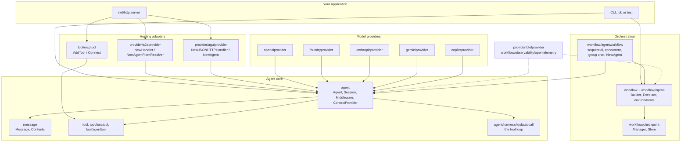

Details: [comprehensive guide](/microsoft-agent-framework-guide/go/microsoft_agent_framework_go_comprehensive_guide/), [providers](/microsoft-agent-framework-guide/go/microsoft_agent_framework_go_providers/).

## The agent run pipeline

A run passes through two layers of middleware. `agent.Config.Middlewares` wrap the whole run, outside history and context providers. `agent.ProviderConfig.Middlewares` wrap the provider's run function; the provider constructors install the tool loop there. Function middleware wraps each tool call.

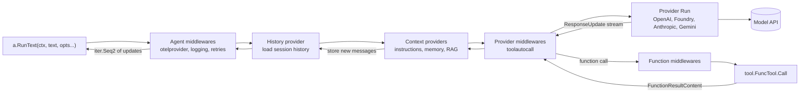

Details: [middleware](/microsoft-agent-framework-guide/go/microsoft_agent_framework_go_middleware/#the-run-pipeline), [tools](/microsoft-agent-framework-guide/go/microsoft_agent_framework_go_tools/#the-tool-loop).

## The tool loop

`toolautocall` turns `FunctionCallContent` into tool invocations and calls the model again, up to `MaximumIterationsPerRequest` rounds (40 by default). When the limit is reached it makes one last call without tools.

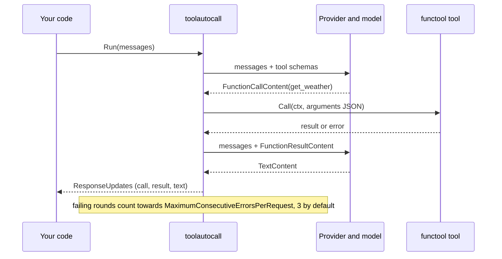

## Tool approvals

A tool wrapped in `tool.ApprovalRequiredFunc` is not called. The run ends with a `ToolApprovalRequestContent` in the response, and the next run on the same session carries the decision.

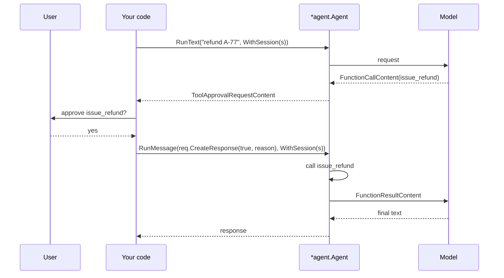

Details: [tools](/microsoft-agent-framework-guide/go/microsoft_agent_framework_go_tools/#approvals).

## Sessions and history

A session is a JSON-serialisable state bag plus an optional service ID. Where the conversation itself lives depends on the provider.

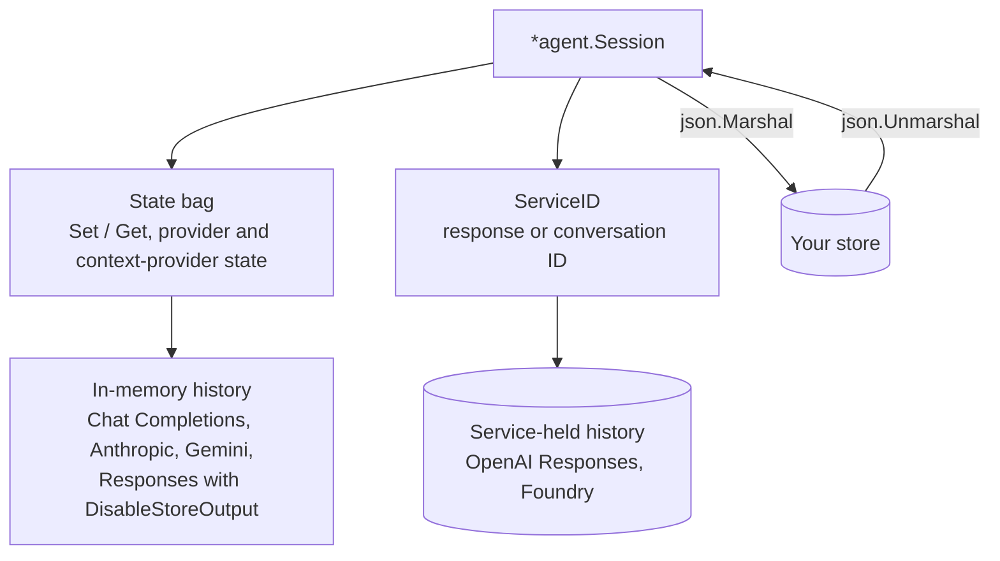

Details: [sessions and memory](/microsoft-agent-framework-guide/go/microsoft_agent_framework_go_sessions_and_memory/).

## Workflow building blocks

The builder stores bindings, not executors. A binding either shares one executor instance between runs (`Bind`) or makes one per run (`BindNewExecutorFunc`).

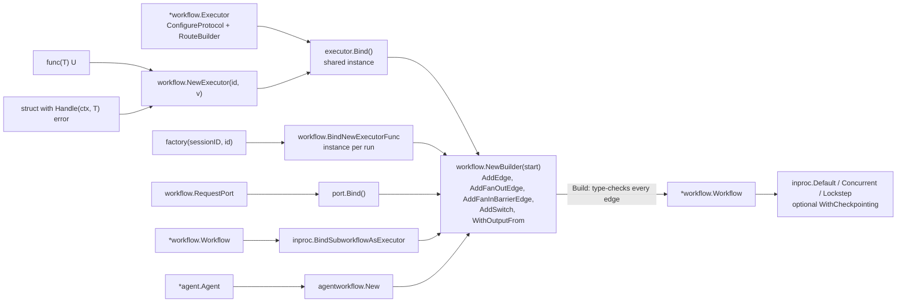

Details: [workflows](/microsoft-agent-framework-guide/go/microsoft_agent_framework_go_workflows/#executors).

## Supersteps

Messages sent in one superstep are delivered at the start of the next. Executors that receive messages in the same superstep run concurrently. State writes are applied at the end of the superstep, and a checkpoint, if enabled, is taken then.

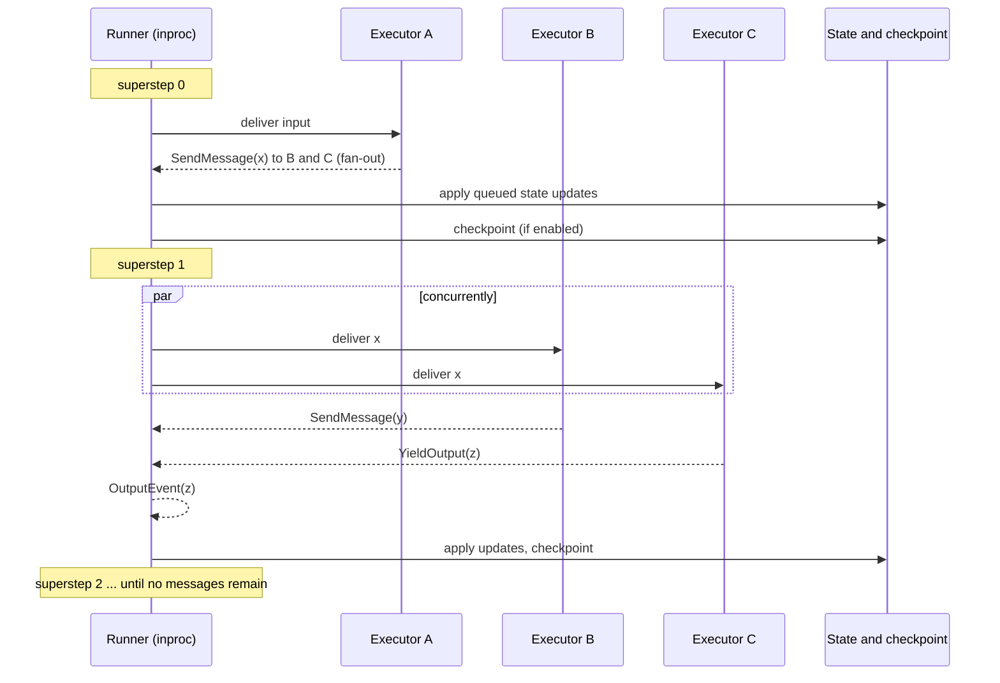

## Run states

`inproc.RunStatus` as a run moves between halts. A halted run accepts more input; one waiting on requests accepts responses.

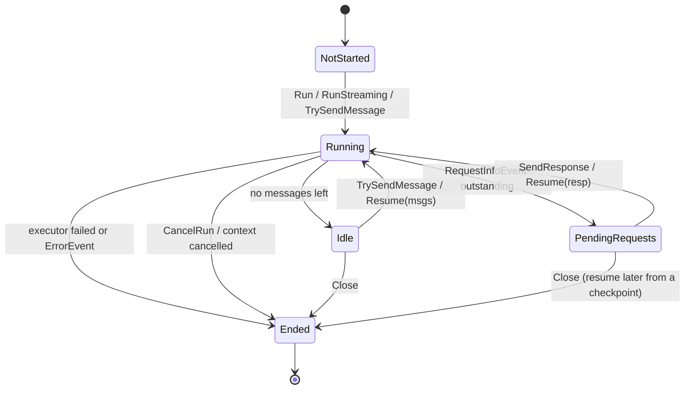

## Human in the loop with a checkpoint

The approval below takes days, so the first process stops after the request is raised. Another process resumes from the latest checkpoint into a freshly built, identical graph; the pending request is re-emitted and answered.

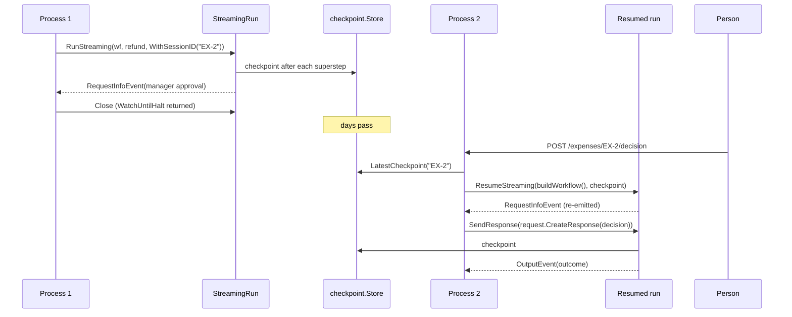

Details: [checkpointing](/microsoft-agent-framework-guide/go/microsoft_agent_framework_go_workflows/#checkpointing), [the expense recipe](/microsoft-agent-framework-guide/go/microsoft_agent_framework_go_recipes/#expense-approvals-over-http).

## Agents as executors: the turn-token protocol

An executor made by `agentworkflow.New` collects chat messages until a `workflow.TurnToken` arrives, runs the agent once, and passes the conversation and the token on. Tool approvals inside the turn become external requests.

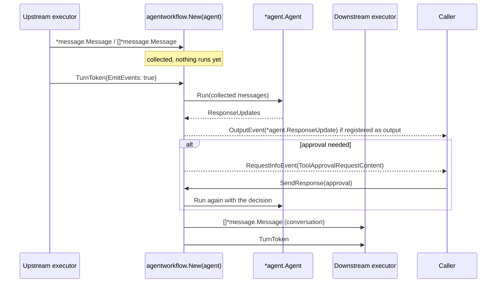

Details: [agents in workflows](/microsoft-agent-framework-guide/go/microsoft_agent_framework_go_workflows/#agents-in-workflows).

## Orchestration topologies

The three prebuilt patterns in `agentworkflow`, as graphs.

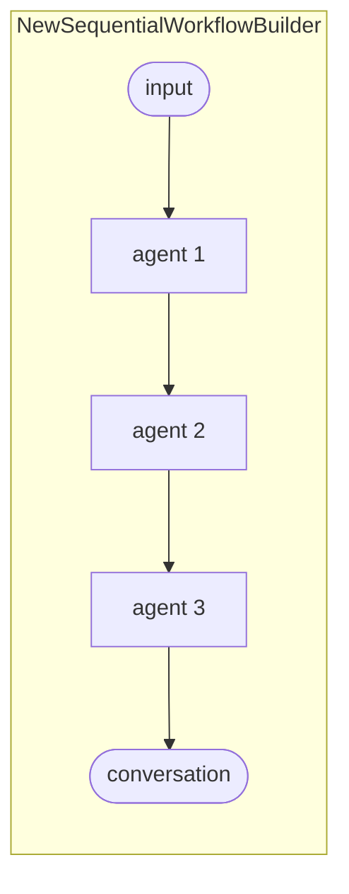

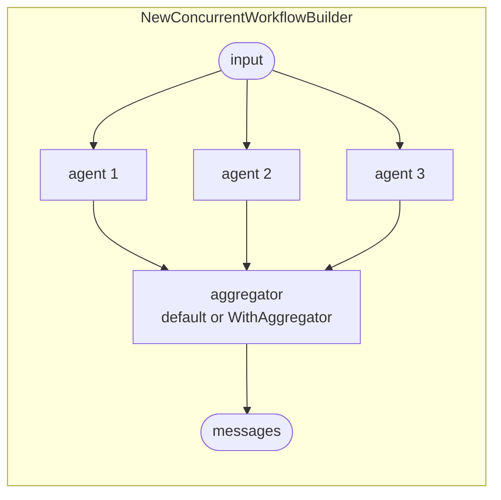

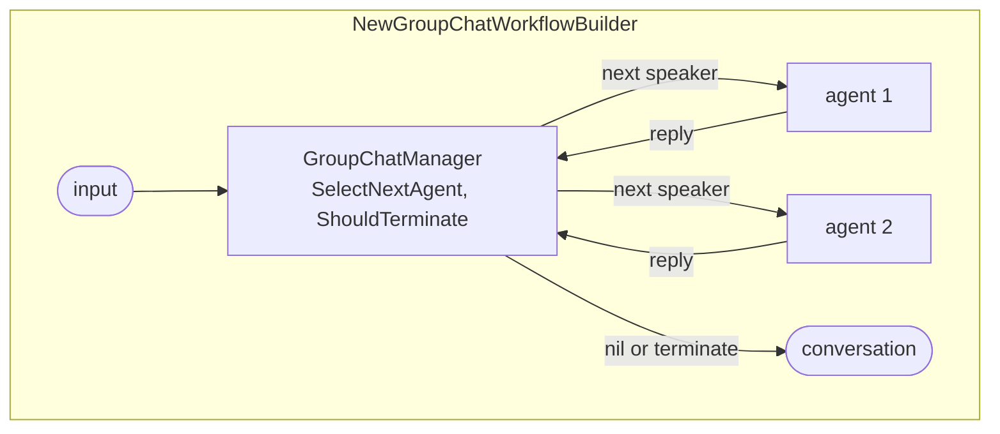

Details: [orchestrations](/microsoft-agent-framework-guide/go/microsoft_agent_framework_go_orchestrations/).

## A workflow as an agent

`agentworkflow.NewAgent` puts a workflow behind the `*agent.Agent` interface. The first run on a session opens a streaming workflow run, and later runs on that session feed it.

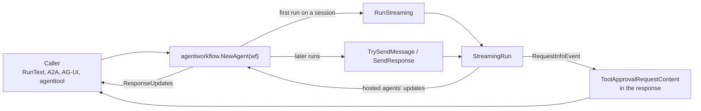

## A2A hosting and tasks

The A2A handler keeps one session per context ID in its `SessionStore`. In task mode, requests become tasks that a client can poll or resubscribe to.

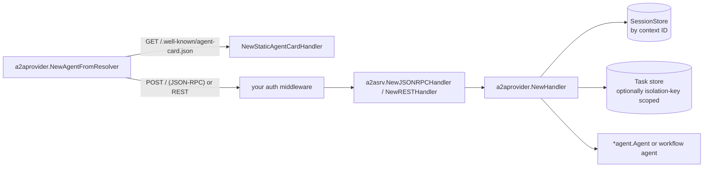

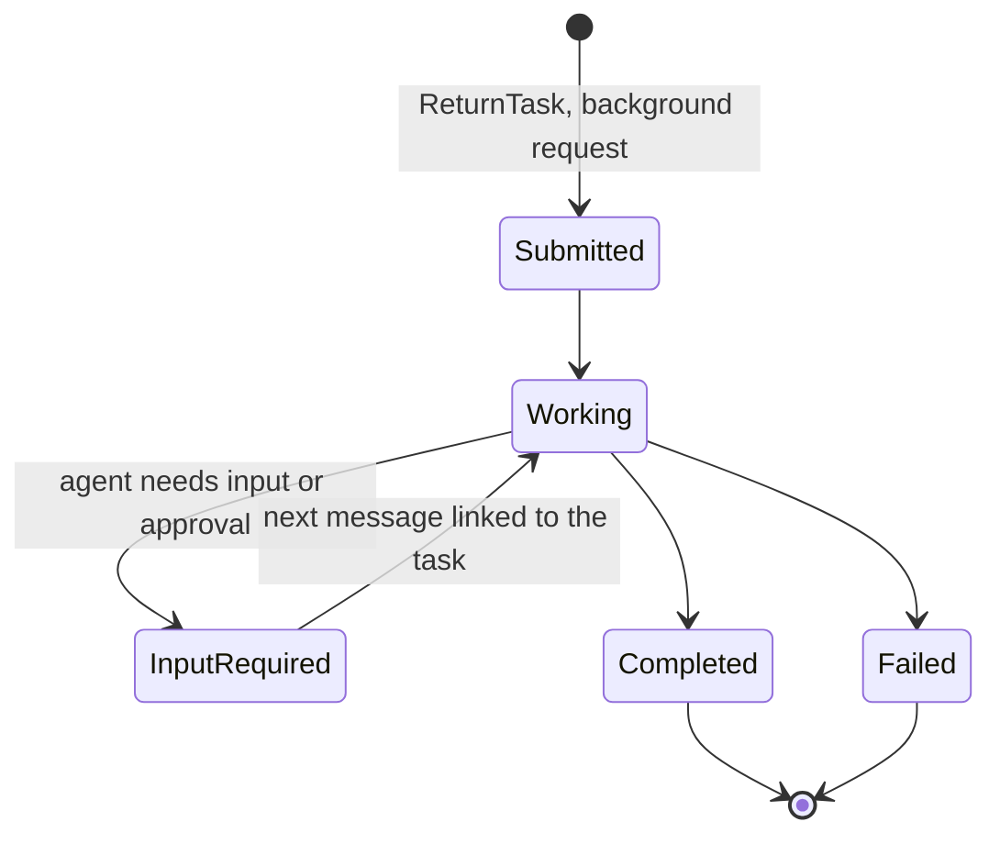

Details: [hosting and A2A](/microsoft-agent-framework-guide/go/microsoft_agent_framework_go_hosting_and_a2a/).

## AG-UI

The AG-UI handler is stateless: the client sends the whole conversation and its own tool declarations with every run, and receives Server-Sent Events.

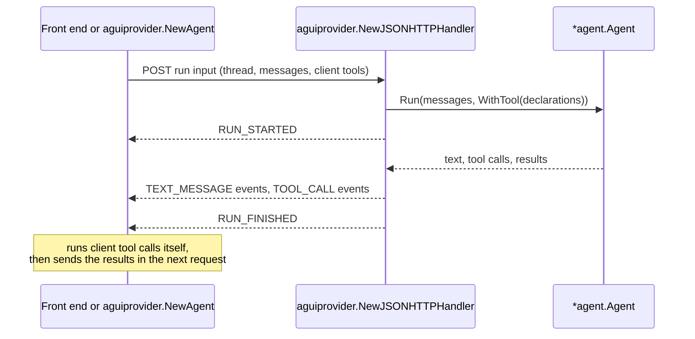

## Telemetry

What one agent run with a tool call looks like in a trace, inside a workflow executor and an incoming HTTP request.

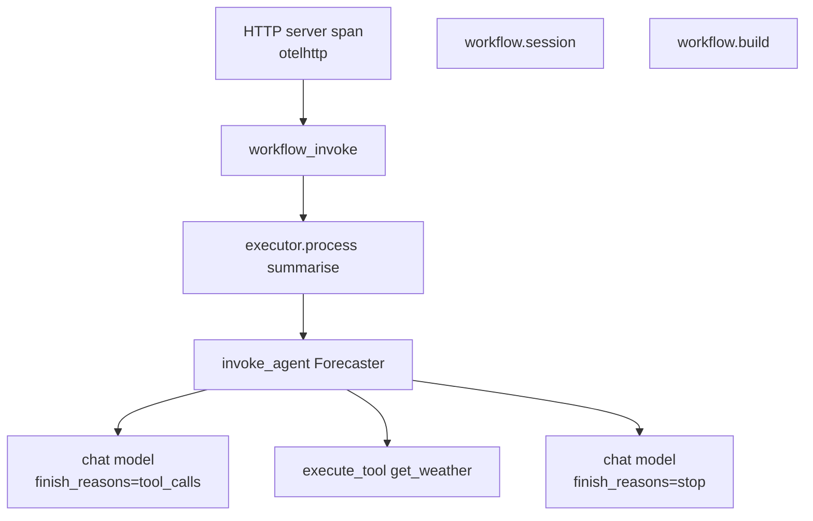

`workflow.build` and `workflow.session` are separate spans, not parents of the run. Details: [observability](/microsoft-agent-framework-guide/go/microsoft_agent_framework_go_observability/).

## A deployment

One way to run the pieces: a stateless Go service, scaled out, with conversation and workflow state in shared stores and telemetry through a collector.

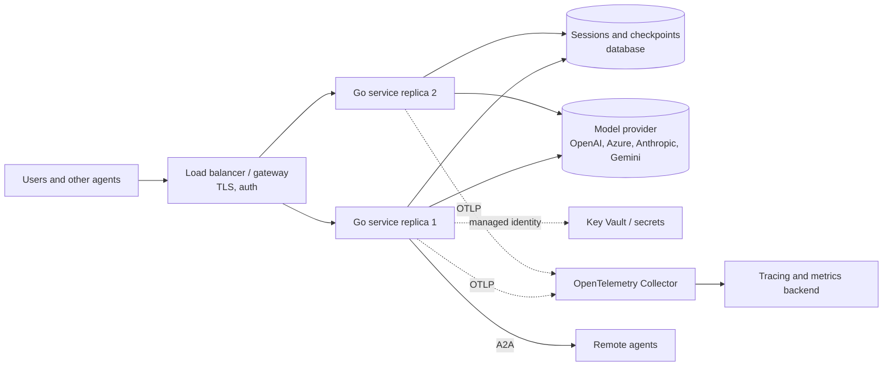

Details: [production](/microsoft-agent-framework-guide/go/microsoft_agent_framework_go_production/).
