These diagrams show how `agent-framework` %%version=agent-framework-rs%% works inside, drawn from its source rather than from the Python SDK's documentation. Where the port behaves differently from Python, the diagram shows the port. Each diagram has a short explanation under it and a link to the page that covers the topic in full.

The diagrams are Mermaid source. Paste one into any Mermaid renderer (GitHub Markdown, the Mermaid live editor, most IDE previews) to see it drawn.

## Crates

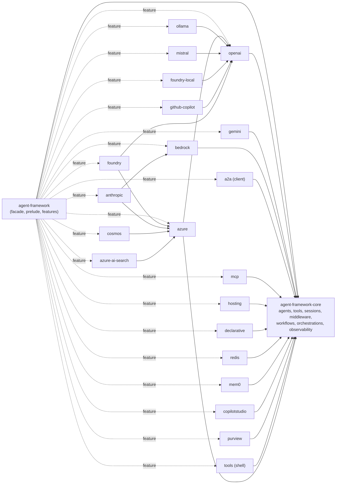

Every companion crate depends on `agent-framework-core`, which has no dependency on any of them; the arrows above are the extra dependencies between companions (each node is `agent-framework-<name>`, and every one also points at core). The facade crate `agent-framework` re-exports core at its root and each companion as a module behind a cargo feature of the same name, so `features = ["anthropic"]` gives `agent_framework::anthropic`. Several providers reuse the OpenAI crate's wire code: Ollama, Mistral, Foundry Local and GitHub Copilot speak Chat Completions, and Azure and Foundry wrap the OpenAI clients with Azure authentication. `anthropic` pulls in `bedrock` and `azure` for Claude on Bedrock and Foundry. `hosting` depends only on core: its A2A server has its own copy of the wire types and does not use the `a2a` client crate. The [overview](/microsoft-agent-framework-guide/rust/#cargo-features) lists the features.

## The agent run pipeline

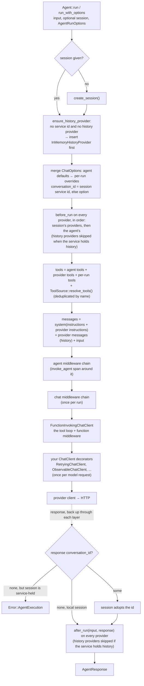

A run first assembles the request, then sends it down a fixed stack of layers, and finally records the result. `prepare_request` attaches an in-memory history provider to a local session that has none, merges the per-run `ChatOptions` over the agent's (the per-run side wins), and runs every context provider's `before_run` over one shared `SessionContext`: the session's providers first, then the agent's own (`with_compaction` registers an agent provider, so compaction sees the history already loaded). Provider instructions are appended after the agent's, provider messages go before the caller's input, and tools from providers, from `AgentRunOptions` and from tool sources (resolved fresh on every run) are added unless the name is taken.

The stack below is fixed at build time. `AgentBuilder::build` wraps the client you passed in a `FunctionInvokingChatClient`, so agent middleware runs once per run, chat middleware runs once per run around the whole tool loop (Python runs chat middleware once per model request), function middleware runs once per tool call, and anything you wrapped around the provider client before `Agent::builder` runs once per model request. On success the session adopts any conversation id the service returned and each provider's `after_run` records the original input and the response; on failure each provider's `after_run` sees the error, its own result is discarded, and the run's error is returned. The [middleware page](/microsoft-agent-framework-guide/rust/microsoft_agent_framework_rust_middleware/#three-levels) and [context and memory](/microsoft-agent-framework-guide/rust/microsoft_agent_framework_rust_context_and_memory/#where-providers-attach-and-the-order-they-run-in) cover the two halves.

### Where agent hooks attach

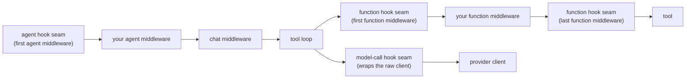

With `experimental-agent-hooks`, `AgentHooks` builds the agent with its seams inserted: one outermost agent middleware, function middleware at both ends of your chain (so it sees the arguments before and after your middleware changes them), and a decorator directly around the raw client, below the tool loop. See [agent hooks](/microsoft-agent-framework-guide/rust/microsoft_agent_framework_rust_middleware/#agent-hooks-experimental).

## Streaming runs

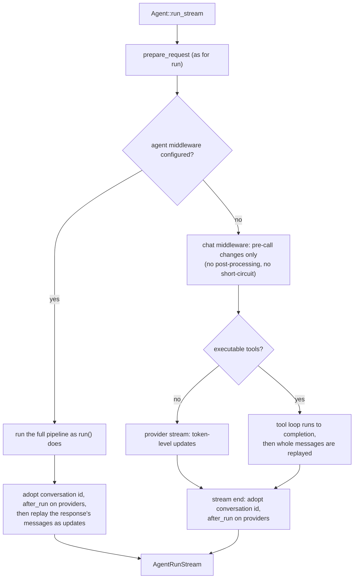

Token-level streaming only happens when there is no agent middleware and no local tool. With agent middleware, `run_stream` goes through the same pipeline as `run` so guardrails apply, records the run, and only then replays the result as updates; with local tools, the tool loop's streaming method runs the whole loop and replays its messages, carrying usage on the last update. Chat middleware on the plain token path can only change the request, because a live stream cannot pass back through `ChatContext::result`. On the other two paths, context providers record the run when the stream ends, so a stream dropped before the end records nothing. See [streaming runs](/microsoft-agent-framework-guide/rust/microsoft_agent_framework_rust_middleware/#streaming-runs).

## The tool loop

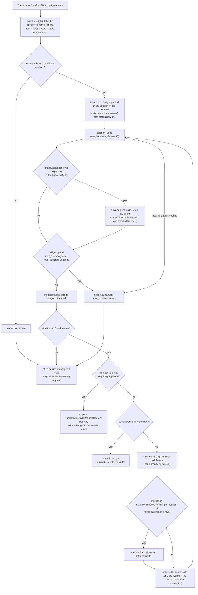

The loop sits below chat middleware and above your client decorators. Every model request goes through it; a reply with no unresolved function calls ends it. The two budgets are graceful: when either is spent the loop sends one last request with tools disabled, so the model answers with what it has, and they are checked between batches so a parallel batch always completes. An unknown tool name gets an error result ("tool 'x' not found") unless `terminate_on_unknown_calls` makes it fail the run; a tool error becomes an error result whose text is "tool execution failed" unless `include_detailed_errors` is set; a middleware failure propagates and fails the run. When the service holds the conversation (a reply carried a conversation id), each later request sends only the new tool results. The [tool loop](/microsoft-agent-framework-guide/rust/microsoft_agent_framework_rust_tools/#the-tool-loop) section gives the limits and their defaults.

## The approval round trip

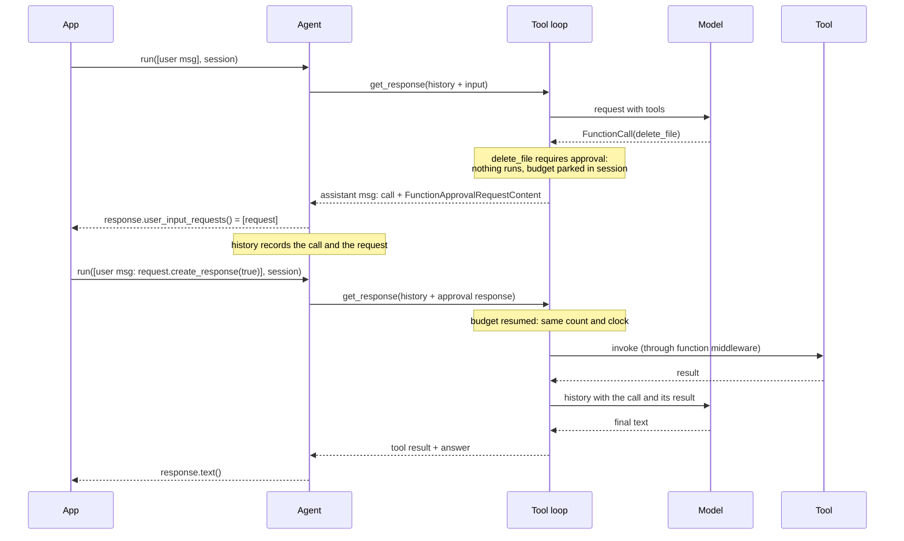

A tool marked `ApprovalMode::AlwaysRequire` is never run on the model's say-so. If any call in a batch needs approval, the loop returns the whole batch as approval requests, each with its own occurrence id, and the session's history records them. The caller answers on the same session with `create_response(true)` or `create_response(false)`; the loop finds the unanswered responses in the conversation, runs the approved calls (a rejected one gets the rejection text as its result), rewrites the request and response pair as an ordinary call and result, and carries on. The call and time budget survive the round trip because they are parked in the session's state, so approve-and-continue cannot reset them. See [approvals](/microsoft-agent-framework-guide/rust/microsoft_agent_framework_rust_tools/#the-approval-round-trip).

## Sessions and history

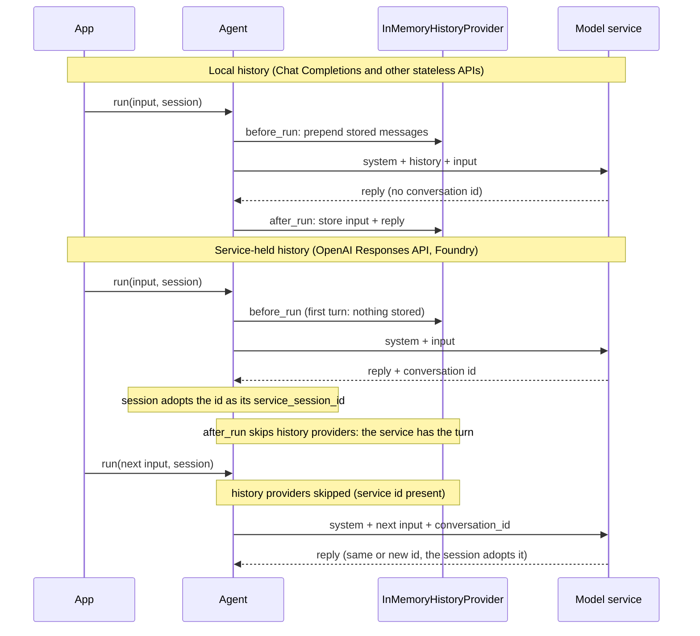

An `AgentSession` holds an id, an optional service-side conversation id, a state bag shared by its clones, and its own list of context providers, one of which is normally a history provider. With a stateless API the in-memory provider (attached automatically on the first run) sends the whole transcript every time and records each turn. When the service returns a conversation id, the session adopts it and from then on history providers are left out of both `before_run` and `after_run`, as .NET does, so turns are not sent twice; a session created with `AgentSession::service(id)` or `create_session_with_service_id` starts in that mode. A service-held session whose reply carries no id fails with `Error::AgentExecution`. `to_dict` saves the ids and the state bag but not the history, which lives in the provider. See [service-held and local history](/microsoft-agent-framework-guide/rust/microsoft_agent_framework_rust_sessions/#service-held-and-local-history).

## The workflow engine

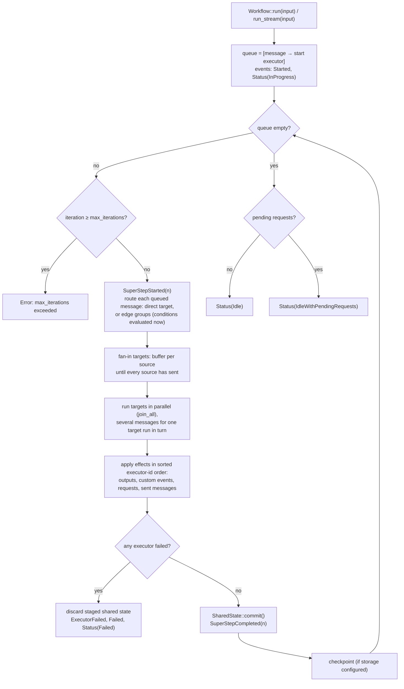

The engine is a Pregel-style loop of supersteps. Messages sent during one superstep are delivered in the next, after routing through the edges, so a condition or switch is evaluated when the message is routed, not when it is sent. All targets of a superstep run concurrently; their effects are then applied in sorted executor-id order, which is why outputs come out in id order. A fan-in target is invoked once, with a JSON array in declared source order, when every source has delivered. A failing executor fails the whole run and its superstep's shared-state writes are discarded. `max_iterations` counts supersteps (100 by default), so a loop in the graph needs a condition that stops it. See [workflows](/microsoft-agent-framework-guide/rust/microsoft_agent_framework_rust_workflows/#concurrency-within-a-superstep).

### Shared state within a superstep

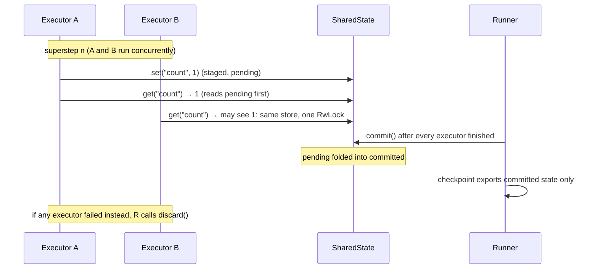

Shared state is one store per run, cloned into every executor's context. Writes are staged and folded into committed state only at the end of a successful superstep, so a checkpoint never holds a half-finished superstep. Reads check the staged writes first, so an executor sees its own writes; executors in the same superstep share the store, so do not rely on either seeing or not seeing the other's writes. Keys starting with `_` are reserved, and a sub-workflow gets its own store. See [shared state](/microsoft-agent-framework-guide/rust/microsoft_agent_framework_rust_workflows/#shared-state).

### Human in the loop and checkpoints

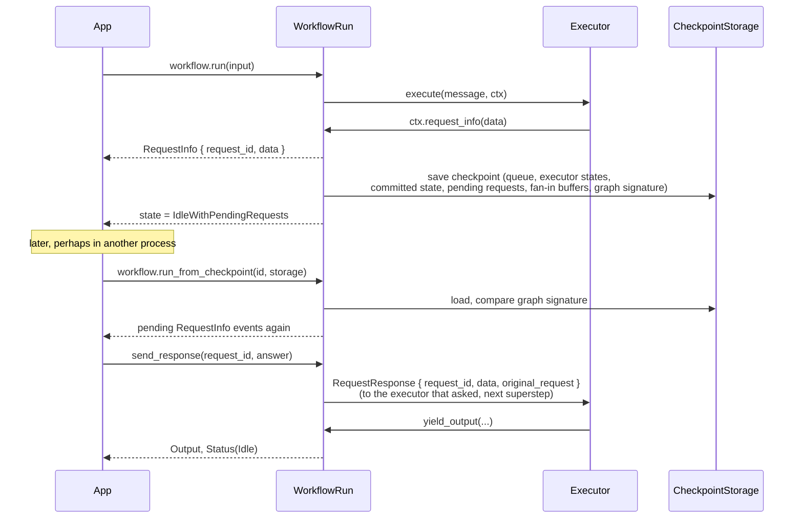

`ctx.request_info` records a request with a fresh id. The run carries on while other messages are queued, then stops as `IdleWithPendingRequests`. `send_response` (or `send_responses` for several) queues a `RequestResponse` to the executor that asked and drives the run again; an unknown request id is an error. With checkpointing on, a checkpoint is saved after every superstep, including the one that raised the request. `run_from_checkpoint` refuses a checkpoint whose graph signature differs from the workflow's (`run_from_checkpoint_unchecked` skips that check), restores executor state, shared state, the queue and pending requests, and re-emits the pending `RequestInfo` events. A failed checkpoint save is logged, not raised. See [human in the loop](/microsoft-agent-framework-guide/rust/microsoft_agent_framework_rust_workflows/#human-in-the-loop) and [checkpointing](/microsoft-agent-framework-guide/rust/microsoft_agent_framework_rust_workflows/#checkpointing).

### Sub-workflows and workflows as agents

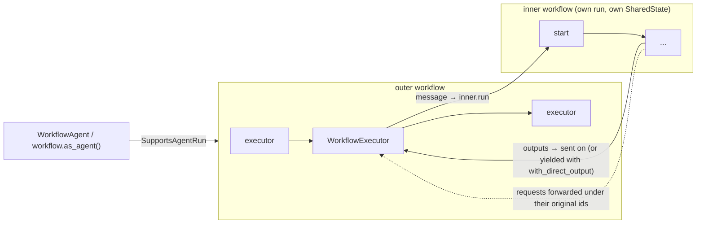

A `WorkflowExecutor` runs another workflow as one node: each message starts an inner run with its own shared state, the inner run's outputs are sent on from the node, and its requests surface from the outer run under their original ids so `send_response` reaches them. `WorkflowAgent` goes the other way and presents a workflow as an agent, so it can be hosted or used as a tool. See [sub-workflows](/microsoft-agent-framework-guide/rust/microsoft_agent_framework_rust_workflows/#sub-workflows).

## Orchestrations

Sequential and concurrent orchestrations build graphs of agent executors. Group chat, handoff and Magentic each build a workflow with a single executor that calls its participants in a loop, so their events all carry one executor id and a whole run is one superstep (or one per human answer).

### Sequential

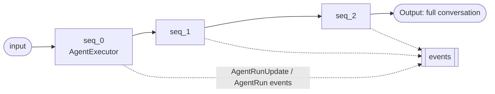

Each executor runs its agent over the whole conversation so far, appends the reply and sends the conversation on; only the last yields it, unless `output_from` or `intermediate_output_from` names other participants. With `with_request_info()` every node is an `AgentApprovalExecutor` instead (below). See [sequential](/microsoft-agent-framework-guide/rust/microsoft_agent_framework_rust_orchestrations/#sequential).

### Concurrent

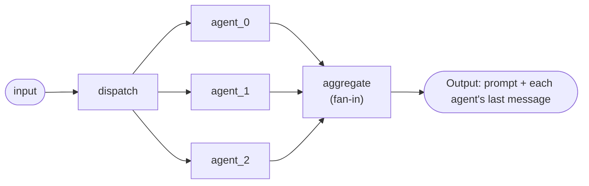

`dispatch` fans the input out, the agents run in the same superstep, and the fan-in delivers their conversations to `aggregate` in participant order. The aggregator keeps the first conversation minus its last message, then the last message of each participant; there is no custom aggregator hook. See [concurrent](/microsoft-agent-framework-guide/rust/microsoft_agent_framework_rust_orchestrations/#concurrent).

### Group chat

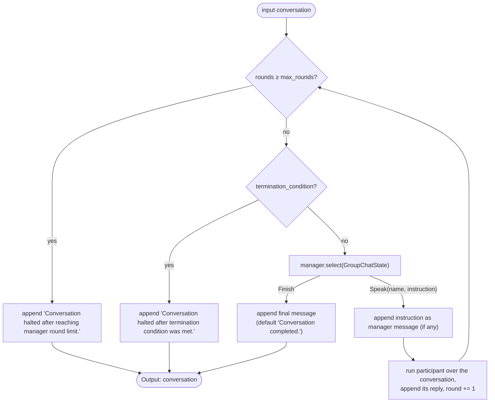

Everything happens inside `group_chat_orchestrator`. The round limit is checked first, then the termination condition, then the manager decides; an unknown participant name fails the run. The manager can be round robin (the default), a closure, your own `GroupChatManager` or an LLM agent. See [group chat](/microsoft-agent-framework-guide/rust/microsoft_agent_framework_rust_orchestrations/#group-chat).

### Handoff

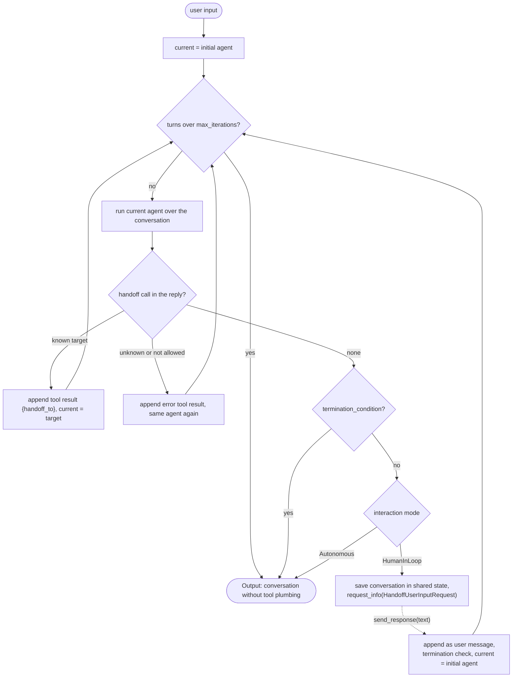

The coordinator reads handoffs from the agents' replies: the tools come from `handoff_tool_spec`, which you attach to each agent yourself, and they are declaration-only, so the agent's tool loop returns the call instead of running it. A handoff to a name that does not resolve, or that `add_handoff` does not allow, is answered with an error tool result and the same agent runs again. In the default human-in-the-loop mode the conversation is kept in shared state (so it is checkpointed) while the run waits, and the user's answer goes to the initial agent. See [handoff](/microsoft-agent-framework-guide/rust/microsoft_agent_framework_rust_orchestrations/#handoff).

### Magentic

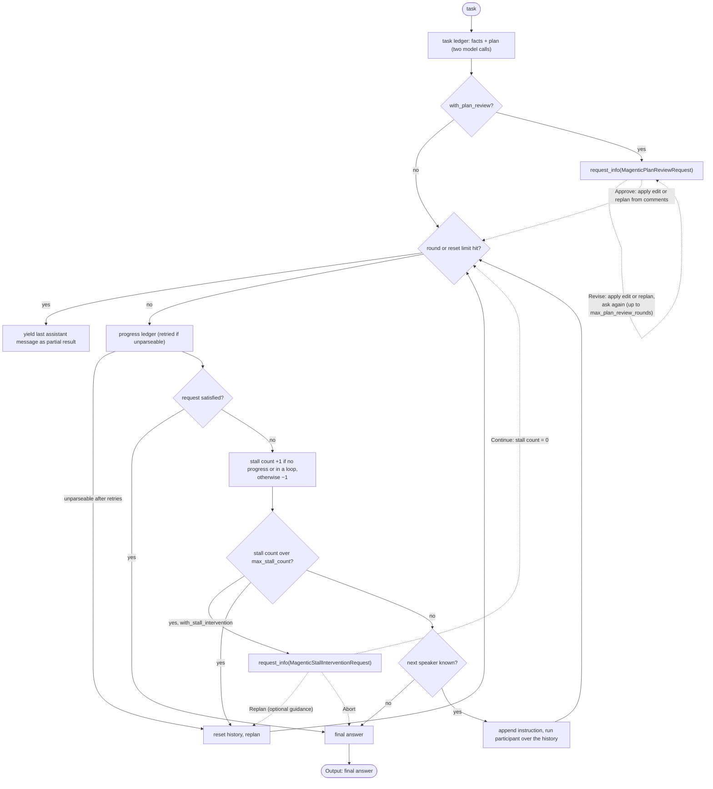

The manager plans first, then each round fills in a progress ledger that says whether the task is done, whether the team is stuck, and who speaks next with what instruction. Stalls accumulate and productive rounds pay them back; past `max_stall_count` the manager resets and replans, or, with stall intervention, asks a person, who can continue, force a replan with guidance, or stop with a final answer. Plan review works the same way before the first round: `Approve` proceeds (adopting an edited plan, or replanning from comments), `Revise` asks again until `max_plan_review_rounds`. Without `max_round_count` or `max_reset_count` the only bound is that cycle, so set a round limit. See [Magentic](/microsoft-agent-framework-guide/rust/microsoft_agent_framework_rust_orchestrations/#magentic).

### Agent approval

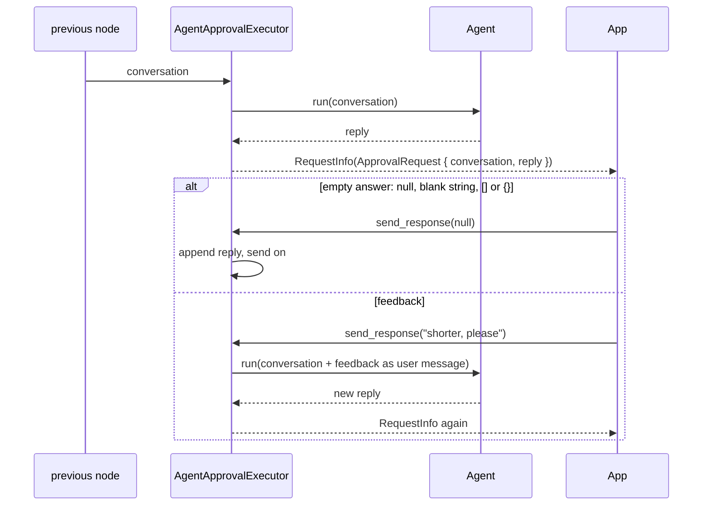

`AgentApprovalExecutor` pauses after the agent has replied, so a person reviews the actual reply. An empty answer approves; anything else is feedback, the agent runs again and a new request is raised. The executor keeps no state of its own: the request carries the conversation and reply, so a checkpoint taken while it waits needs nothing else. See [agent approval](/microsoft-agent-framework-guide/rust/microsoft_agent_framework_rust_orchestrations/#agent-approval).

## Hosting

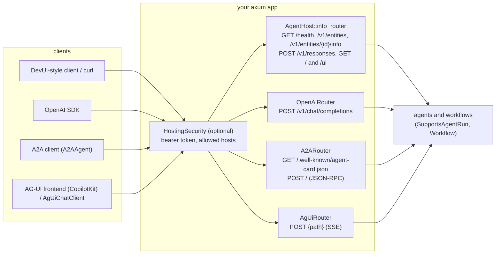

Each surface is an `axum::Router` you merge or nest into one app. All of them call the agent through `SupportsAgentRun` (`run`, or `run_stream` for streamed requests), and none keeps a conversation between requests, except AG-UI with a snapshot store. A2A `message/send` completes each task synchronously. `AgentHost::with_bearer_token` and `with_allowed_hosts` protect only the DevUI routes, so wrap the composed router with `HostingSecurity` to protect every surface. See [securing and composing](/microsoft-agent-framework-guide/rust/microsoft_agent_framework_rust_hosting/#securing-and-composing).

## MCP client lifecycle

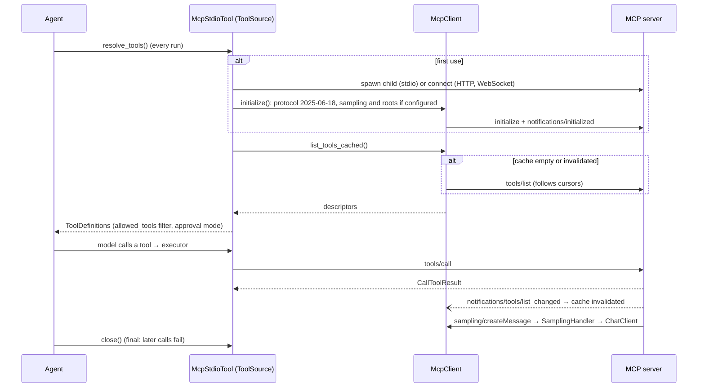

A tool type owns one lazily created session. Registered with `tool_source`, it is asked for its tools at the start of every run: the first call spawns or connects and runs the handshake, and later calls are served from a cache that the server's `list_changed` notification clears. `tool_definitions()` is the one-off alternative that freezes the list at build time. A failure to connect or list fails the agent run. There is no reconnection: once the server dies or `close()` is called, build a new tool. See [lifecycle, errors and reconnecting](/microsoft-agent-framework-guide/rust/microsoft_agent_framework_rust_mcp/#lifecycle-errors-and-reconnecting).

## Telemetry spans

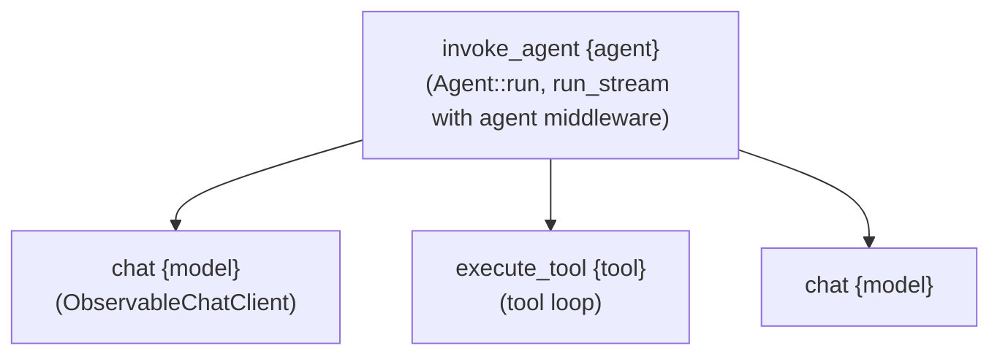

One run with one tool call produces this tree when the provider client is wrapped in `ObservableChatClient`: the agent span from the run, one `chat` span per model request from the decorator, and an `execute_tool` span per local call from the tool loop. Where `ObservableChatClient` sits relative to `RetryingChatClient` decides whether a retried request is one span or one per attempt. See [observability](/microsoft-agent-framework-guide/rust/microsoft_agent_framework_rust_observability/#spans).
